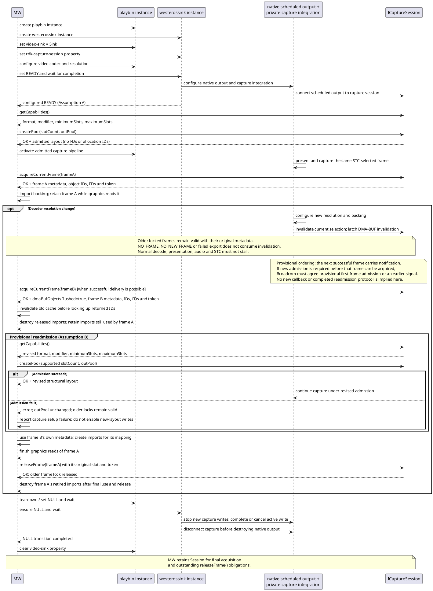

# SoC Video Frame Capture Specification

**Status:** Draft for review.

**Specification version:** 0.8

## Revision history

| Version | Status | What changed | What reviewers should check |
|---|---|---|---|
| 0.8 | Draft for review | Added configured-pipeline minimum/maximum slot limits, stable DMA-BUF object IDs, cached graphics imports and resolution-change invalidation. | Post-READY query assumption, acquisition-time identity/layout, retained old frames, and provisional pool readmission; resolution-change notification ordering remains open. |
| 0.7 | Draft for review | Added mandatory EGL/OpenGL ES and Vulkan requirements and clarified the logical capture reservation model. | Graphics import and lifetime, retention-capacity admission, logical slot and object keys, acquisition-specific FDs, and stable backing while locked. |
| 0.6 | Draft for review | Changed ICaptureSession delivery from GstContext to Gst property based on feedback that GstContext is pipeline-wide, not element-specific. Added westeros-sink-soc.h contract changes for property handling. Uprev to v0.6. | Property-based delivery approach, westeros-sink-soc.h contract changes, Section 6 restructuring to 5 focused sections |
| 0.5 | Draft for review | Added ICaptureSession delivery mechanism documentation, clarifying comments to Westeros example showing platform-dependent factory selection, and factory function example. No API contract changes. | Delivery mechanism documentation, example clarity, and version bump. |
| 0.4 | Draft for review | Kept the existing platform video sink as playbin's selected sink, supplied the capture session directly to that sink, permitted direct or private-helper capture integration, and added sink-compatibility checks. | Existing-sink association, property handling, scheduled-output attachment, preservation of normal sink behavior and properties, reference ownership, teardown, and integration tests. |
| 0.3 | Draft for review | Expanded frame representation and acquisition safety, made pool and FD ownership explicit, and defined the complete per-pipeline GStreamer integration with construction and test examples. | Plane/object layout, acquisition tokens, failure invariants, process-local FD ownership, pool provisioning, playbin/session association, reference ownership, teardown, and conformance tests. |
| 0.2 | Draft for review | Changed frame acquisition so the HAL returns each newly selected frame once instead of repeatedly returning the same slot. Clarified that several previously returned frames may remain locked at the same time. | Frame acquisition and release, behavior when there is no newer frame, slot exhaustion, flush, and teardown. |
| 0.1 | Initial draft | Introduced the capture session, DMA-BUF pool, GStreamer attachment, frame selection, and lifetime contract. | Complete specification. |

### What changed in version 0.8

- Query minimum and maximum frame-slot counts after pipeline codec and resolution configuration, provisionally at `READY`.
- Identify backing with stable DMA-BUF object IDs; export independently owned FDs on every successful acquisition.
- Reuse graphics imports after frame release without permitting access to released content.
- Report DMA-BUF invalidation on the next successful acquisition after a resolution change, preserving older retained frames.
- Provisionally requery and repeat `createPool()` when resolution changes require different capacity or layout. The notification/readmission sequence still requires Broadcom agreement; this draft does not claim that sequence is complete.

### What changed in version 0.7

- Required direct import of every advertised capture format, modifier, and concrete plane/object layout through both EGL/OpenGL ES and Vulkan.
- Added modifier-aware DMA-BUF import, external-texture and YCbCr sampling, and correctly interpreted RGB(A) requirements.
- Defined EGL and Vulkan FD ownership, failure rollback, graphics-resource destruction, and HAL release ordering.
- Added a vendor graphics capability declaration without extending the HAL or public API.
- Moved the frame/plane/object conceptual model into Section 7 before the concrete representation examples.
- Clarified that `CapturePool` admits concurrent retention and describes a fixed layout; it does not require a separate copied-frame pool or permanently assigned DMA-BUF backing.
- Uprev to v0.7.

### What changed in version 0.6

- Changed ICaptureSession delivery from GstContext to Gst property based on feedback that GstContext is pipeline-wide, not element-specific.
- Added westeros-sink-soc.h contract changes for property handling, including required struct fields and contract function.
- Restructured Section 6 from 7 sections to 5 focused sections.
- Uprev to v0.6.

### What changed in version 0.5

- Added documentation for ICaptureSession delivery mechanism, specifying that SoC vendor provides a shared library with a factory function.
- Added factory function example showing how MW calls the vendor factory to obtain ICaptureSession.
- No API contract changes; interface signatures and method behaviors remain unchanged.

### What changed in version 0.4

- The normal platform policy resolves and creates the concrete video sink before `READY`; the same sink remains assigned to playbin's `video-sink` property.
- MW supplies the pipeline-local `ICaptureSession` directly to that sink through the `rdk-capture-session` property.
- The platform sink implements capture directly or owns a private helper attached to its native scheduled-output path while preserving normal presentation and the existing sink contract.
- The revision provides a complete MW lifecycle example, non-normative Westeros property plumbing, a runnable plumbing prototype requirement, and aligned conformance tests.

### What changed in version 0.3

- The pool keeps the indexed DMA-BUF object and plane layout introduced in 0.2, but no longer exports FDs at pool creation. Each successful acquisition exports one MW-process-local FD for every DMA-BUF object referenced by that slot.
- Each acquisition now carries a unique token. `releaseFrame()` validates the slot and token so a stale frame cannot release a newer lock after slot reuse.
- `CapturedFrame` is non-copyable and move-constructible, with deleted move assignment. FD ownership remains separate from the one required frame release.
- Failed HAL calls leave outputs unchanged, close descriptors created by the failed attempt, roll back temporary locks, and create no new caller obligation. Different slots cannot expose overlapping byte ranges.
- The previous explicit `gst_frame_capture_attach()`/`detach()` side channel is replaced by one explicitly selected `framecapture` video sink or sink-bin per playbin. A pipeline-local GObject property supplies that sink with its borrowed `ICaptureSession`.
- `createPool()` admits retention capacity and the fixed layout before GStreamer enters `READY`. `READY` validates compatibility and connects native scheduled output to the accepted capture contract.
- Section 6 adds complete construction and rollback code plus a vendor integration-test template covering property validation, reference ownership, scheduled-output teardown, and concurrent-pipeline isolation.

### What changed in version 0.2

- `acquireCurrentFrame()` now returns `NO_NEW_FRAME` when the current scheduler selection has already been returned. In this case it does not change `outFrame` or create another lock.
- A successful acquisition still locks the returned slot. Different acquired frames may keep different slots locked concurrently until MW releases them.
- The HAL decides whether a frame is new from its scheduler state, not by comparing reusable slot indices.
- The flush, slot-exhaustion, pipeline-teardown, and late-release rules now follow the new acquisition behavior.
- The conformance checks now cover repeated and concurrent acquisition, multiple locked slots, slot reuse, and post-teardown release.

---

## 0. Contract boundary

This specification defines the in-process contract between **MW** and the **SoC vendor**:

```text
MW
 ├── knows the pipeline output requirement before graph construction
 ├── requests capture capacity and retains the returned layout
 ├── supplies the session to the existing platform video sink
 └── owns returned FDs and matching frame releases

SoC vendor
 ├── implements ICaptureSession
 ├── integrates capture with the existing platform video sink
 ├── connects the capture session to native scheduled output
 └── provides EGL/OpenGL ES and Vulkan import for the configured capture layout
```

MW means the middleware component that calls the HAL. This specification covers graphics import and texture sampling of an acquired frame; later application composition and display are outside its scope.

---

## 1. Purpose

This specification defines how the SoC vendor exposes decoded clear-video frames to MW.

`ICaptureSession` admits the capture capacity and tracks logical slots while frames are retained. The SoC vendor chooses how those slots are backed from its private native output.

This adds to the existing SoC decode stack; it does not replace it.

## 2. Roles and responsibilities

| Role | Definition | Responsibilities |
|------|------------|------------------|
| **MW** | The middleware that calls the HAL. | - Determines each pipeline's output requirement before graph construction<br>- Obtains one session, queries configured limits and admits concurrent retention capacity<br>- Retains each frame's concrete import description<br>- Obtains the pipeline's existing platform video sink, sets its session property, and assigns that same sink to playbin<br>- Closes returned FDs and releases acquired frames<br>- Keeps the session alive until sink teardown and all releases are complete |
| **SoC vendor** | The provider of the decoder, capture, and graphics import implementation. | - Implements `ICaptureSession` and each advertised configured layout<br>- Integrates capture with the existing platform video sink, directly or through a private helper<br>- Owns native queue and backing management<br>- Observes the native scheduled-output frame selection<br>- Provides EGL/OpenGL ES and Vulkan direct import and sampling for each returned layout<br>- Preserves normal presentation and the platform sink contract<br>- Exports FDs atomically and preserves locked frame contents<br>- Keeps decode, audio, STC, and scheduled selection running when capture slots are exhausted<br>- Tears down safely and accepts required late releases |

### 2.1 Vendor delivery information

For integration and review, the SoC vendor supplies:

1. support for the `rdk-capture-session` GObject property on westerossink;
2. a runnable plumbing prototype showing property receipt before `READY`, playbin assignment, normal presentation, and teardown;
3. the concrete `CaptureCapabilities` values;
4. the configured pool layout and supported slot counts;
5. evidence that pipeline-local association, native selection, locking, FD export, exhaustion, sink teardown, late release, normal presentation, and existing sink behavior meet this specification; and
6. any platform constraint that makes Video Frame Capture unsupported; and
7. **ICaptureSession delivery mechanism**: The SoC vendor provides a shared library with a factory function to create ICaptureSession instances. The factory function signature is:

```cpp
ICaptureSession* createCaptureSession(const CaptureConfig& config);
```

The library naming convention is platform-specific (e.g., `libcapture-<vendor>.so`). MW loads the library using the platform's normal library discovery mechanism (e.g., `dlopen()`), resolves the factory symbol, and calls it to obtain an ICaptureSession instance. The application retains ownership of the session and must destroy it (via the vendor-provided destruction function or by calling the factory's `destroyCaptureSession()` method) after the pipeline has reached NULL and all acquired frames have been released. The session lifetime must exceed the sink's READY state; the sink borrows the session pointer and does not take ownership.

8. **WesterosSinkSoC ICaptureSession integration**: The SoC vendor must extend their westeros-sink-soc.h contract to support ICaptureSession delivery via the `rdk-capture-session` GObject property as specified in Section 6.3. This includes:
   - Adding `captureSession` and `captureSessionEnabled` fields to `GstWesterosSinkSoc`
   - Implementing `gst_westeros_sink_soc_set_capture_session()`
   - Connecting capture during NULL→READY
   - Disconnecting capture during READY→NULL
9. a graphics capability matrix for the configured capture layout, declaring:
   - EGL/OpenGL ES extension or core-equivalent functionality;
   - Vulkan extension or core-equivalent functionality;
   - EGL-supported DRM formats and modifiers, including the reported external-only status;
   - Vulkan `VkFormat` and DRM-modifier pairs, sampled-image support, external-memory importability, disjoint-plane support where applicable, and sampler-YCbCr conversion support;
   - direct support for each configured layout's exact plane count/order, offsets and strides, and the shared, separate or mixed DMA-BUF mappings returned on acquisition; and
   - YCbCr matrix, full or narrow range, and chroma-siting support for the advertised capture format.

The graphics capability matrix is integration evidence. It does not add fields to `CaptureCapabilities`, `CapturePool`, `ICaptureSession`, or any public API.

The vendor also provides whatever private decoder or scheduled-output access the sink's capture integration needs. That access must not interfere with native scheduling, STC progression, audio presentation, normal playback, sink properties, decoder discovery, subtitle integration, or secondary-video behavior.

## 3. Scope

### What this specification defines

- The capture session and configured pool layout.
- Association with native scheduled output and its frame selection.
- Frame-plane, DMA-BUF object, crop, format, modifier, and timestamp metadata.
- Atomic frame acquisition, FD ownership, frame locks, and release.
- Direct EGL/OpenGL ES and Vulkan import, texturing, graphics-resource lifetime, and cleanup for the advertised capture layout.
- Synchronization, slot exhaustion, sink teardown, and late release.

### 3.1 Terminology

The contract uses these terms exclusively:

| Term | Meaning |
|---|---|
| **Current selection** | The frame chosen by native scheduled output for the current STC/display position. |
| **Frame** | The current selection's timestamp, visible region, slot, and exported FDs. One successful acquisition creates one frame lock. |
| **Slot** | One logical position in the bounded set of frames that may be retained concurrently. It is not necessarily a physical buffer or native queue index. |
| **Slot layout** | The admitted plane template for a logical slot in the current configuration; acquired frames supply concrete object bindings. |
| **Frame plane** | One DRM image plane and its byte range and stride within a DMA-BUF object. It owns no FD. |
| **DMA-BUF object** | One backing allocation, which may contain several DRM planes. |
| **DMA-BUF object ID** | An opaque identity for one backing allocation, stable across releases and reacquisitions until DMA-BUF invalidation. It is neither an FD nor a vector position. |
| **Exported DMA-BUF** | The acquisition-specific binding between one object ID and one valid MW-process FD. On success, `fd >= 0` is owned and must be closed; `-1` is invalid. The FD is not a frame lock. |
| **Pool** | The admitted concurrent frame-retention capacity and layout for the current configuration. It contains no FDs and does not require a separate native queue or copied frames. |

The document does not use “buffer” as a synonym for either slot or frame. “Decoder output buffer” is used only when referring to a vendor-native object outside the capture-pool contract.

## 4. Mandatory ownership model

The following behavior is normative; native queue and backing management remain private to the SoC vendor:

> `createPool()` confirms that the requested number of captured frames can be retained safely. How the vendor provides that capacity is private and may use existing native buffers; a separate capture-buffer allocation is not required. `ICaptureSession` owns the logical slot and lock state.

MW owns the session from the caller side and releases each acquired frame exactly once. The SoC vendor owns the slot state and backing implementation.

The backing bound to an acquired frame must remain unchanged until its matching `releaseFrame()`. After successful release, a later acquisition may reuse the logical slot with different backing and newly exported FDs. Pipeline teardown must not invalidate an outstanding acquired frame; resources needed to complete its late release remain valid until the session is closed.

Capture-slot exhaustion must not block decode, native scheduled selection, audio presentation, or STC progression.

FD lifetime and frame-content lifetime are separate. MW owns and explicitly closes every FD returned by a successful acquisition. Closing an FD does not release the frame lock, and an open FD does not preserve stable contents after release. MW completes every downstream use before calling `releaseFrame()`; after release, it must not access that frame and the SoC may reuse the slot.

A successful acquisition also guarantees that decoder writes, cache maintenance, and SoC-side synchronization are complete, so the selected slot is safe to read. The HAL returns no graphics fence. MW completes downstream use before release, while any decoder, capture, cache, or native fence handling remains private to the SoC implementation.

## 5. Session lifecycle and selection state

### 5.1 Pipeline-scoped lifetime

MW knows whether a pipeline requires capture before graph construction. Each capture-enabled pipeline has one dedicated `ICaptureSession`. MW attaches that session to the sink, configures the pipeline's video codec and resolution, queries the session's limits, and calls `createPool()` before enabling capture output.

**Assumption A — query timing:** this draft assumes native codec and resolution configuration is available after the configured pipeline reaches `READY`. Only then may MW call session `getCapabilities()` and `createPool()`. `READY` alone does not prove that playbin has negotiated caps or prerolled; Broadcom must confirm this milestone. Early public Rialto graphics-support queries are separate from this configured-session query.

A session belongs to one pipeline and is never reassociated or reused. Its lifetime extends beyond sink teardown until the final acquisition opportunity is resolved or abandoned and every acquired frame is released.

### 5.2 Selection state

The session passively tracks the native STC scheduler's current captured selection, whether that selection has already been acquired, and every active frame lock. Selection identity is independent of reusable slot identity: a released slot may later hold a different selection that returns `OK` once.

A slot is writable only when it has no frame lock and no write in progress. Before reusing an unlocked current slot, the session atomically invalidates the old selection so concurrent acquisition returns `NO_FRAME` rather than observing an overwrite. Section 9 defines acquisition and release semantics.

### 5.3 Post-teardown behavior

The platform sink first completes the disconnection contract in Section 6.4. The session, final current selection, and locked slots then remain valid while MW completes these obligations:

1. An unacquired final selection remains available once; transient `NO_RESOURCES` leaves it available for retry.
2. An already acquired final selection returns `NO_NEW_FRAME`, and no valid final selection returns `NO_FRAME`.
3. The session continues accepting `releaseFrame()` for every acquired frame, whose contents remain valid until release.
4. MW destroys the session only after the final acquisition opportunity is resolved or abandoned and every frame lock is released.

The selection does not advance after sink teardown.

## 6. GStreamer integration and scheduled-output behavior

### 6.1 Required integration model

The platform video sink is westerossink. MW creates the westerossink instance, assigns it to playbin's `video-sink` property, sets the `rdk-capture-session` property on the westerossink instance, and drives it to READY to validate capture integration. Capture integrates with the existing surface and video-plane output.

The platform sink integrates capture directly or owns a private helper attached to its native scheduled-output path. The helper may be a private object or child GStreamer element. The public pipeline topology remains unchanged.

For every returned frame, the vendor implementation uses the same STC and scheduling rules as native scheduled output. It publishes only a selection established after decoder consumption. `CapturedFrame.presentationTimeNs` is the selected frame's PTS in that scheduler timeline.

Capture preserves normal presentation and the platform sink's existing contract, including its properties, surface output, decoder discovery, subtitle integration, secondary-video behavior, and scheduling. A pipeline not requesting capture uses the same platform sink without a capture session and is otherwise unaffected.

Each capture-enabled pipeline has one independent relationship:

```text
playbin instance
  -> westerossink instance
       -> capture integration (direct or private helper)
            -> ICaptureSession
                 -> admitted capture reservation and layout
```

Concurrent or dual video uses one complete relationship per pipeline. Sink A receives session A and can access only reservation A; sink B receives session B and can access only reservation B. The SoC implementation does not choose among active playbins. If a vendor-private graph contains multiple scheduled-output branches, the platform sink associates the session with the exact branch represented by that sink instance.

### 6.2 Session-property contract

The property name is `rdk-capture-session` with type G_TYPE_POINTER and value type `ICaptureSession *`. The pointer is opaque to GStreamer and borrowed by the sink. MW keeps it valid until sink teardown completes and retains the session longer when final acquisition or late release remains possible.

MW sets the property directly on the westerossink instance before any state transition that can start decoder output. The sink accepts exactly one non-null session. Reapplying the same pointer is idempotent; a null pointer or attempt to replace it with a different session is invalid.

During `NULL`→`READY`, the sink accepts the session and configures its native output association without requiring a pool. Invalid association or native setup fails the transition with a GStreamer error and rolls back partial setup. After configured `READY`, MW queries limits and calls `createPool()`; capture writes and publication remain disabled until admission succeeds. Admission failure starts no capture writes and MW rolls the pipeline back to `NULL`.

The property does not own the session, create a pool, or carry the `CapturePool` description. Private access to backing and scheduler state remains inside the paired vendor implementations.

### 6.3 WesterosSinkSoC contract

Each SoC-specific `westeros-sink-soc.h` must extend the `GstWesterosSinkSoc` struct with the following fields:

```cpp
struct _GstWesterosSinkSoc
{
    // ... existing fields ...

    // ICaptureSession support
    void *captureSession;              // Borrowed ICaptureSession pointer
    gboolean captureSessionEnabled;   // Whether capture session is active
};
```

Each SoC-specific `westeros-sink-soc.c` must implement the following contract function:

```cpp
gboolean gst_westeros_sink_soc_set_capture_session(
    GstWesterosSink *sink,
    void *session);
```

**Semantics**:
- Input: `sink` - WesterosSink instance, `session` - ICaptureSession pointer (borrowed, not owned)
- Return: TRUE if session accepted, FALSE if rejected
- Must validate that session is non-null
- Must store session in `sink->soc.captureSession`
- Must set `sink->soc.captureSessionEnabled = TRUE`
- Must reject if session is already set (idempotent: reapplying same session is OK, different session is error)

The common `westeros-sink.c` must implement a property handler for `rdk-capture-session`:

```cpp
static void gst_westeros_sink_set_property(GObject *object, guint prop_id, const GValue *value, GParamSpec *pspec)
{
    GstWesterosSink *sink = GST_WESTEROS_SINK(object);

    switch (prop_id)
    {
        case PROP_RDK_CAPTURE_SESSION:
        {
            gpointer session = g_value_get_pointer(value);
            if (!gst_westeros_sink_soc_set_capture_session(sink, session))
            {
                GST_ERROR_OBJECT(sink, "Failed to set capture session");
            }
            break;
        }
        default:
            G_OBJECT_WARN_INVALID_PROPERTY_ID(object, prop_id, pspec);
            break;
    }
}
```

The property must be registered in the class_init function.

**Timing requirements**:
- **Connect**: During NULL→READY, associate the session with native output in `gst_westeros_sink_soc_null_to_ready()`; do not require a pool or start capture writes. Query configured limits and admit the pool afterward, before enabling capture.
- **Disconnect**: During READY→NULL, before decoder teardown, in `gst_westeros_sink_soc_ready_to_null()`

This timing separates native association at `READY` from later pool admission, as specified in Section 6.2.

**Session lifetime**: The ICaptureSession pointer is borrowed by the sink. MW keeps it valid until sink teardown completes and retains the session longer when final acquisition or late release remains possible. The sink does not take ownership of the session.

### 6.4 Middleware lifecycle

The lifecycle below includes construction, a resolution change and teardown. The resolution-change sequence is provisional under Assumption B; the note identifies the notification/readmission ordering still requiring Broadcom agreement.



The application selects Video Frame Capture through its media API before pipeline construction. It does not manipulate GStreamer objects or pass `ICaptureSession` directly. MW performs the integration using one session and the westerossink instance.

MW creates westerossink, assigns it to playbin's `video-sink`, and sets `rdk-capture-session` before state change. The configured pipeline reaches `READY` under Assumption A, then MW queries limits and admits the pool. Successful association alone does not prove admission, preroll or media activation.

MW retains `session` and the admitted `outPool`; the pool description is not passed back to the sink. Each successful acquisition supplies its concrete allocation IDs and import description. An initial construction failure returns the sink to `NULL`; MW discards that session and uses a fresh one for a retry.

Pipeline teardown takes playbin to `NULL`, which destroys the westerossink instance. MW retains the session until teardown completes, the final acquisition opportunity is resolved, and every acquired frame has been released.

**Obtaining ICaptureSession from vendor library**: MW loads the vendor-provided shared library using the platform's normal library discovery mechanism (e.g., `dlopen()`), resolves the factory symbol, and calls it to obtain an ICaptureSession instance. The application retains ownership of the session and must destroy it after the pipeline has reached NULL and all acquired frames have been released.

### 6.5 Prototype and conformance testing

A vendor can use the same helper shape with a test `ICaptureSession` and an instrumented westerossink. At minimum, an integration test verifies:

```cpp
TEST(FrameCaptureIntegration, PreservesPlatformSinkAndAssociatesSession)
{
    TestCaptureSession session;
    GstElement *playbin = gst_element_factory_make("playbin", nullptr);
    CapturePool pool;

    ASSERT_NE(playbin, nullptr);

    ASSERT_TRUE(configureFrameCaptureOutput(
        playbin, session, 4, pool));

    GstElement *configuredSink = nullptr;
    g_object_get(playbin, "video-sink", &configuredSink, nullptr);
    ASSERT_NE(configuredSink, nullptr);
    ASSERT_STREQ(GST_ELEMENT_NAME(configuredSink), "westerossink");

    EXPECT_EQ(session.createPoolCallCount(), 1u);
    EXPECT_EQ(session.requestedSlotCount(), 4u);
    EXPECT_EQ(testCaptureSession(configuredSink), &session);
    EXPECT_TRUE(testScheduledOutputConnected(configuredSink));
    EXPECT_TRUE(testNormalPresentationActive(configuredSink));
    EXPECT_TRUE(existingSinkPropertiesUnchanged(configuredSink));

    ASSERT_TRUE(teardownFrameCaptureOutput(playbin));

    gst_object_unref(configuredSink);
    gst_object_unref(playbin);
}
```

The test functions are vendor test hooks, not production APIs. Additional tests create two playbins with two westerossink instances and two sessions and verify that each sink reaches only its own session and pool. Failure tests cover null session property, repeated property with a different session, incompatible `READY` setup, and rollback to `NULL` without capture writes.

The vendor supplies a runnable plumbing prototype using westerossink or an instrumented build of westerossink. The prototype demonstrates property receipt on the westerossink instance before `READY`, successful `READY` validation, assignment to playbin, normal presentation, and confirmed `NULL` teardown. It need not implement frame export while validating this plumbing.

The integration suite also verifies that normal scheduled presentation continues while capture is enabled; existing sink properties retain their values and effects; decoder discovery, subtitle integration, secondary-video behavior, geometry, visibility, and immediate-output behavior remain usable; capture-slot exhaustion omits capture without blocking presentation; and teardown disconnects capture before scheduled output is destroyed. Final acquisition and late `releaseFrame()` remain valid after sink teardown.


## 7. Capture value types

```cpp
enum class CaptureStatus : uint32_t
{
    OK,
    NO_NEW_FRAME,
    UNSUPPORTED,
    INVALID_ARGUMENT,
    NO_RESOURCES,
    NO_FRAME,
    FATAL_ERROR,
};

constexpr uint32_t kInvalidCaptureSlotIndex = std::numeric_limits<uint32_t>::max();
constexpr uint64_t kInvalidAcquisitionToken = 0;

struct Size
{
    uint32_t width;
    uint32_t height;
};

struct Rectangle
{
    uint32_t x;
    uint32_t y;
    Size size;
};

struct CaptureCapabilities
{
    uint32_t size{sizeof(CaptureCapabilities)};
    uint32_t drmFormat;
    uint64_t drmModifier;
    Size maximumContentSize;
    uint32_t minimumSlots;
    uint32_t maximumSlots;
};

struct DmaBufObject
{
    uint64_t objectId;
    uint64_t sizeBytes;
};

struct FramePlane
{
    uint32_t planeIndex;
    uint64_t dmaBufObjectId;
    uint64_t offsetBytes;
    uint64_t lengthBytes;
    uint32_t strideBytes;
};

struct CaptureSlotLayout
{
    uint32_t slotIndex;
    std::vector<FramePlane> planes;
};

struct ExportedDmaBuf
{
    uint64_t dmaBufObjectId;
    int fd{-1};
};

struct CapturePool
{
    Size backingSize;
    std::vector<CaptureSlotLayout> slotLayouts;
};

struct CapturedFrame
{
    uint32_t slotIndex{kInvalidCaptureSlotIndex};
    uint64_t acquisitionToken{kInvalidAcquisitionToken};
    int64_t presentationTimeNs;
    Rectangle visibleRegion;
    bool dmaBufObjectsFlushed{false};
    CaptureCapabilities capabilities{};
    Size backingSize{};
    std::vector<DmaBufObject> dmaBufObjects;
    std::vector<FramePlane> planes;
    std::vector<ExportedDmaBuf> exportedDmaBufs;

    CapturedFrame() : presentationTimeNs{0}, visibleRegion{} {}
    CapturedFrame(const CapturedFrame &) = delete;
    CapturedFrame &operator=(const CapturedFrame &) = delete;
    CapturedFrame(CapturedFrame &&other) noexcept;
    CapturedFrame &operator=(CapturedFrame &&other) noexcept = delete;
    ~CapturedFrame() = default;
};
```

The value types follow these rules:

- Pool `backingSize` gives admitted slot dimensions for that configuration. Acquired `backingSize` describes the returned frame; neither size alone identifies physical backing.
- `DmaBufObject.sizeBytes` gives the size available for range validation in the identified acquired allocation. Reporting it does not allocate or export an FD.
- MW owns each successful `fd >= 0`, closes it explicitly, and sets it to `-1`. `-1` means invalid. Destructors do not close FDs.
- `CapturedFrame` is non-copyable. A valid `slotIndex` and matching `acquisitionToken` mean exactly one `releaseFrame()` is owed, independently of FD ownership.
- The HAL assigns a unique non-zero `acquisitionToken` for each successful acquisition. The token is opaque; MW must not interpret or reconstruct it.
- Moving a frame through the move constructor transfers its metadata, FDs, token, and release obligation without `dup()` or `close()`. The source FDs become `-1`, its `slotIndex` becomes `kInvalidCaptureSlotIndex`, and its `acquisitionToken` becomes `kInvalidAcquisitionToken`.
- Move assignment is deleted to avoid undefined behavior when the destination is non-empty. To reuse an existing instance, callers must release its frame lock, close and invalidate its FDs, return it to the empty state, and pass it to `acquireCurrentFrame()`; transferring ownership to a different object requires the move constructor.
- Pool `slotIndex` values equal their positions in `slotLayouts`, are contiguous from zero and cannot equal `kInvalidCaptureSlotIndex`. Object IDs are opaque non-zero `uint64_t` values, not positions. Their width is proposed for vendor review. Zero means an allocation is not yet bound in an admitted slot template; acquired planes must never use zero.
- Each acquired frame carries its own `capabilities`, `backingSize`, `dmaBufObjects` and ordered `planes`, atomically describing the backing exported in that call. Admission returns structural slot templates with object IDs set to zero, not invented allocation identities. Concrete object sizes and plane-to-object bindings are supplied on acquisition.
- An object ID identifies the same allocation and compatible import properties until `dmaBufObjectsFlushed` invalidates the cache. IDs may be reused after invalidation, never silently rebound before it. Slot reuse and numeric FD reuse do not establish object identity.
- `planeIndex` follows the plane order defined by the reported DRM format. Import code maps that order to its graphics API.
- Each plane references one valid object. Validate its range without overflow: `offsetBytes <= sizeBytes` and `lengthBytes <= sizeBytes - offsetBytes`. The range and stride must fit the advertised layout.
- For any two planes that belong to different slots and can be bound within the same physical DMA-BUF object, their half-open byte ranges `[offsetBytes, offsetBytes + lengthBytes)` must not overlap. Planes within one slot may share an object as defined by that format. Binding simultaneously locked slots to distinct physical allocations also provides the required content isolation.
- For every `OK` frame, validate `visibleRegion` without overflow: `x <= backingSize.width`, `size.width <= backingSize.width - x`, `y <= backingSize.height`, and `size.height <= backingSize.height - y`.
- Import properties remain compatible for each object ID until invalidation. Storage not exposed as a DRM plane remains part of its DMA-BUF object.
- On `OK`, `exportedDmaBufs` contains exactly one entry for each distinct object referenced by that frame's `planes`, with no duplicate or unrelated object. Join `FramePlane.dmaBufObjectId`, `DmaBufObject.objectId` and `ExportedDmaBuf.dmaBufObjectId` within the returned frame.
- Every locked frame has stable backing until release. A later selection may reuse its allocation and ID with newly exported FDs, or return an unknown ID requiring a new import.
- `dmaBufObjectsFlushed` is false by default. Its meaning and pending-notification rules are defined in Section 9. Moving transfers it and all import metadata; the moved-from flag becomes false. Resetting a released, FD-free frame clears the flag and old metadata before output reuse.

Plane count, object count, and FD count are independent.

A `CapturedFrame` is empty only when its `slotIndex` is invalid, its `acquisitionToken` is invalid, and every FD is `-1`. Closing all FDs does not make a frame empty while its slot index and token remain valid; the frame lock still requires release.

FDs are exported only when a frame is acquired. MW owns and closes them. Closing an FD does not release the frame lock, and `releaseFrame()` does not inspect FD values.

### 7.1 Conceptual model

The relationships are directional and do not imply one-to-one cardinality:

```
Frame (selected content and timing)
  └── Slot layout
       ├── Frame plane 0 ──references──> DMA-BUF object A ──exported as──> FD for A
       ├── Frame plane 1 ──references──> DMA-BUF object A ──same object, no second FD
       └── Frame plane 2 ──references──> DMA-BUF object B ──exported as──> FD for B
```

- A **Frame** is decoded content written to one reusable slot at a specific STC selection.
- Its **slot layout** contains one logical record for each DRM plane.
- Each **frame plane** references exactly one **DMA-BUF object** ID and describes its byte range and stride within that acquired allocation.
- Several planes may reference the same object at different offsets, or each plane may reference a different object. Mixed arrangements are valid.
- A successful acquisition exports one FD for each distinct object referenced by the selected slot, never one FD per plane by implication.
- `dmaBufObjectId` identifies physical backing between invalidations. The process-local FD is only a transferred handle for that backing. The same allocation may arrive through different FDs.

### 7.2 Valid frame representations

The following examples describe successful acquisition metadata, not admission templates. IDs 101 and 205 are illustrative opaque allocation IDs; FD values are illustrative process-local handles. Each object appears once in `dmaBufObjects` and exports once per acquisition.

**Example A — one plane, one object, one FD**

```text
plane 0 ──> object 101 ──> FD 10
```

```cpp
dmaBufObjects = {{.objectId = 101, .sizeBytes = S}};
planes = {{.planeIndex = 0, .dmaBufObjectId = 101,
           .offsetBytes = 0, .lengthBytes = S, .strideBytes = P}};
exportedDmaBufs = {{.dmaBufObjectId = 101, .fd = 10}};
```

**Example B — two planes sharing one object and one FD**

```text
plane 0 ──> object 101 @ offset 0 ──> FD 10
plane 1 ──> object 101 @ offset N ──> same FD 10
```

```cpp
dmaBufObjects = {{.objectId = 101, .sizeBytes = S}};
planes = {
    {.planeIndex = 0, .dmaBufObjectId = 101,
     .offsetBytes = 0, .lengthBytes = N, .strideBytes = P0},
    {.planeIndex = 1, .dmaBufObjectId = 101,
     .offsetBytes = N, .lengthBytes = S - N, .strideBytes = P1},
};
exportedDmaBufs = {{.dmaBufObjectId = 101, .fd = 10}};
```

**Example C — two planes, two objects, two FDs**

```text
plane 0 ──> object 101 ──> FD 10
plane 1 ──> object 205 ──> FD 11
```

```cpp
dmaBufObjects = {
    {.objectId = 101, .sizeBytes = S0},
    {.objectId = 205, .sizeBytes = S1},
};
planes = {
    {.planeIndex = 0, .dmaBufObjectId = 101,
     .offsetBytes = 0, .lengthBytes = S0, .strideBytes = P0},
    {.planeIndex = 1, .dmaBufObjectId = 205,
     .offsetBytes = 0, .lengthBytes = S1, .strideBytes = P1},
};
exportedDmaBufs = {
    {.dmaBufObjectId = 101, .fd = 10},
    {.dmaBufObjectId = 205, .fd = 11},
};
```

**Example D — shared and separate objects in one frame**

```text
plane 0 ──> object 101 @ offset 0 ──> FD 10
plane 1 ──> object 101 @ offset N ──> same FD 10
plane 2 ──> object 205 @ offset 0 ──> FD 11
```

```cpp
dmaBufObjects = {
    {.objectId = 101, .sizeBytes = S0},
    {.objectId = 205, .sizeBytes = S1},
};
planes = {
    {.planeIndex = 0, .dmaBufObjectId = 101,
     .offsetBytes = 0, .lengthBytes = N, .strideBytes = P0},
    {.planeIndex = 1, .dmaBufObjectId = 101,
     .offsetBytes = N, .lengthBytes = S0 - N, .strideBytes = P1},
    {.planeIndex = 2, .dmaBufObjectId = 205,
     .offsetBytes = 0, .lengthBytes = S1, .strideBytes = P2},
};
exportedDmaBufs = {
    {.dmaBufObjectId = 101, .fd = 10},
    {.dmaBufObjectId = 205, .fd = 11},
};
```

After releasing Example C's frame, a later selection may return IDs 101 and 205 with FDs 30 and 31. MW reuses the compatible cached image, closes the unused new FDs, and holds the new frame lock until graphics reads finish. If that acquisition instead has `dmaBufObjectsFlushed == true`, MW first invalidates the old cache and imports the returned mapping anew, even if the IDs are numerically unchanged.

### 7.3 DRM NV12 linear example

For this example, `CaptureCapabilities` reports `DRM_FORMAT_NV12` and `DRM_FORMAT_MOD_LINEAR`; the acquired frame supplies the concrete plane/object layout in the examples above. Linux `drm_fourcc.h` defines NV12 as a two-plane format and the modifier as linear storage. An NV12 slot may represent plane 0 (luma Y) and plane 1 (interleaved chroma UV) using either Example B, where both planes reference one DMA-BUF object at different offsets and acquisition exports one FD, or Example C, where each plane references a separate object and acquisition exports two object-ID-labelled FDs. The modifier does not determine DMA-BUF object or FD cardinality; the plane-to-object mapping in the slot layout does. These examples define representational capability, while an implementation must still advertise and provide an arrangement importable through every required graphics path.

### 7.4 Capture layout

`getCapabilities()` reports the configured format, modifier, dimensions limit and minimum/maximum retained frame-slot counts. `createPool()` admits the requested count and reports `backingSize` and ordered slot-plane templates with offsets, lengths and strides. Templates use zero object IDs because no acquired allocation is identified yet. On acquisition, `CapturedFrame` supplies the concrete non-zero IDs, object sizes, plane bindings and capability snapshot for that selection. The implementation need not support every arrangement in the examples, but must support both required graphics import paths for each layout it returns.

Every slot supports `backingSize`, which must not exceed `maximumContentSize`. `slotLayouts.size()` equals the requested frame count, inclusively between `minimumSlots` and `maximumSlots`. Admission and acquisition must ensure that concurrently locked frames have isolated contents: separate physical allocations or non-overlapping plane byte ranges in shared allocations. Object and FD counts do not determine the slot count.

**Assumption B — resolution changes:** a decoder resolution change may alter limits, dimensions, modifier, plane layout or pool capacity. MW requeries limits and repeats `createPool()` for a revised configuration; this provisionally replaces the once-per-session restriction. Existing locked frames keep their original metadata and valid contents until release. The returned frame's metadata must never be interpreted through a newer pool description. If the requested retention count is no longer supported, MW chooses a supported count or reports capture setup failure; the HAL must not silently clamp it.

The sequence for learning about such a change is still open: `dmaBufObjectsFlushed` is delivered only on a successful acquisition, but a replacement pool might be required before a new frame can be acquired. Broadcom must confirm whether the first notification-bearing frame can be admitted provisionally, or whether an earlier agreed signal is needed. This draft adds no callback or acknowledgement and does not claim a complete readmission sequence. Failure to support a layout must be reported as `UNSUPPORTED` or `FATAL_ERROR`, not hidden as successful capture. Outstanding locks remain valid and unrelated playback remains available.

## 8. Graphics import and texturing requirements

### 8.1 Common requirements

A conforming implementation supports both EGL/OpenGL ES and Vulkan import paths for its configured capture contract. In each path, the imported resource directly references the acquired frame's DMA-BUF backing. An intermediate copy or conversion into different backing does not satisfy this requirement.

Both paths use the acquired frame's capability snapshot, dimensions, object sizes, ordered planes and object-to-FD bindings. They support its exact format, modifier, offsets, lengths, strides and shared, separate or mixed object mapping. A combination is supported only when it can be sampled, not merely queried or imported.

MW caches imports by the ordered object-ID/plane mapping and complete import description, including colour interpretation, within one session and graphics context/device. A frame with two separately exported luma/chroma objects still consumes one slot and may use one image referencing both objects. Known compatible IDs reuse an import; unknown IDs create it lazily. Close redundant transferred FDs on cache hits because no import takes their ownership. Never use FD values or slot indices as cache identity. Keep at most the configured number of reusable frame-image entries, evicting unused entries if more backing identities appear over time. Old retained entries awaiting invalidation cleanup can temporarily exceed that cache bound; the slot count is not an individual-object or total-memory bound.

For a YUV capture layout, sampling returns correctly interpreted RGB(A) using the source matrix, full or narrow sample range, and chroma siting. The graphics implementation performs that interpretation during external-texture or sampler-YCbCr sampling; the consumer is not required to sample raw YUV planes or select the conversion.

All graphics work reading a frame completes before its matching `releaseFrame()`. Cached imports may remain alive afterward, but MW must not sample them again until a new successful acquisition locks that backing. Reusing an import does not reuse a released frame lease. Successful acquisition guarantees completed decoder writes, cache maintenance and SoC-side synchronization as specified in Section 4; no graphics fence is added.

When `dmaBufObjectsFlushed` is true, invalidate the old cache before resolving the returned IDs. Destroy released entries; keep imports referenced by older retained frames until their GPU work completes and their frame locks are released, then destroy them. Do not reinsert them into the new cache even if IDs match. Capture destruction evicts remaining unused imports; the graphics context/device must outlive every retained frame and its eventual cleanup.

Extension functionality promoted into a core API version satisfies the corresponding requirement. The vendor capability declaration identifies whether each requirement is provided by an extension or by core functionality.

### 8.2 EGL DMA-BUF image import

The EGL implementation provides the functionality defined by:

- `EGL_EXT_image_dma_buf_import`, including the `EGL_LINUX_DMA_BUF_EXT` image target and the DRM format and plane FD, offset, and pitch attributes;
- `EGL_EXT_image_dma_buf_import_modifiers`, including per-plane modifier low/high attributes and `eglQueryDmaBufFormatsEXT()` / `eglQueryDmaBufModifiersEXT()`; and
- EGL image creation and destruction through `eglCreateImage()` / `eglDestroyImage()`, or the equivalent `eglCreateImageKHR()` / `eglDestroyImageKHR()` functionality defined by `EGL_KHR_image_base`.

`EGL_LINUX_DMA_BUF_EXT` is the image target defined by `EGL_EXT_image_dma_buf_import`; it is not an extension name.

MW constructs the image attributes from the capture records as follows:

- `CaptureCapabilities.drmFormat` supplies `EGL_LINUX_DRM_FOURCC_EXT`;
- each DRM plane uses the FD for its `dmaBufObjectId`, repeating that FD in the attribute list when several planes reference the same DMA-BUF object;
- `FramePlane.offsetBytes` and `strideBytes` supply the matching plane OFFSET and PITCH attributes;
- `CaptureCapabilities.drmModifier` supplies every plane's `EGL_DMA_BUF_PLANE*_MODIFIER_LO_EXT` and `EGL_DMA_BUF_PLANE*_MODIFIER_HI_EXT` attributes; and
- the source colour metadata available to the vendor integration supplies `EGL_YUV_COLOR_SPACE_HINT_EXT`, `EGL_SAMPLE_RANGE_HINT_EXT`, `EGL_YUV_CHROMA_HORIZONTAL_SITING_HINT_EXT`, and `EGL_YUV_CHROMA_VERTICAL_SITING_HINT_EXT`.

`eglQueryDmaBufFormatsEXT()` and `eglQueryDmaBufModifiersEXT()` report the advertised format and modifier. Their result also identifies whether the combination is external-only; external-only support is valid because Section 8.3 requires the external-texture path.

EGL image creation does not transfer ownership of the supplied DMA-BUF FDs. After `eglCreateImage()` or `eglCreateImageKHR()` returns, MW closes every supplied FD copy that is no longer needed for another import attempt, on both success and failure. A successful EGL image retains the imported backing until `eglDestroyImage()` or `eglDestroyImageKHR()`.

A failed EGL import closes every MW-owned FD and destroys every EGL image created by that attempt. It leaves no graphics resource associated with the frame.

### 8.3 OpenGL ES external-texture binding and sampling

The OpenGL ES implementation provides:

- `GL_OES_EGL_image` and `glEGLImageTargetTexture2DOES()`;
- `GL_OES_EGL_image_external`, `GL_TEXTURE_EXTERNAL_OES`, and `samplerExternalOES`;
- `GL_OES_EGL_image_external_essl3` for ESSL 3 external-texture shaders; and
- the core texture operations `glGenTextures()`, `glBindTexture()`, `glTexParameteri()`, and `glDeleteTextures()`.

MW creates one external texture for each EGL image used to expose the frame. All resources in one frame use `GL_TEXTURE_EXTERNAL_OES`. After binding that target, MW associates the EGL image with the texture by calling `glEGLImageTargetTexture2DOES()` and configures texture parameters valid for an external texture. Sampling through `samplerExternalOES` returns the interpreted RGB(A) values required by Section 8.1.

The resource order is:

1. create the EGL image from the acquired DMA-BUF layout;
2. create and bind the GL texture, then associate the EGL image with `glEGLImageTargetTexture2DOES()`;
3. retain the acquired frame until all graphics work reading it has completed;
4. call `releaseFrame()` exactly once, retaining compatible EGL/GL imports in the cache for future acquisitions; and
5. on cache eviction or final cleanup, delete the unused texture with `glDeleteTextures()`, then destroy its EGL image with `eglDestroyImage()` or `eglDestroyImageKHR()`. Older retained frames defer this cleanup as described in Section 8.1.

Failure after partial construction deletes created textures, destroys created EGL images, closes all MW-owned FDs, and preserves the frame lock until that rollback is complete.

### 8.4 Vulkan DMA-BUF image import and sampling

The Vulkan implementation provides the functionality defined by:

- `VK_KHR_external_memory`;
- `VK_KHR_external_memory_fd`;
- `VK_EXT_external_memory_dma_buf`, including `VK_EXTERNAL_MEMORY_HANDLE_TYPE_DMA_BUF_BIT_EXT`;
- `VK_EXT_image_drm_format_modifier`;
- `VK_KHR_get_memory_requirements2` and `VK_KHR_bind_memory2`, or their core equivalents; and
- `VK_KHR_sampler_ycbcr_conversion`, or Vulkan 1.1 core functionality, for YUV capture formats.

The complete query, import, and texturing path provides:

- `vkEnumerateDeviceExtensionProperties()` or core-version checks to establish the required functionality;
- `vkGetPhysicalDeviceFeatures2()` to confirm sampler-YCbCr conversion support where required;
- `vkGetPhysicalDeviceFormatProperties2()` with `VkDrmFormatModifierPropertiesListEXT` to identify sampled-image support for the DRM modifier;
- `vkGetPhysicalDeviceImageFormatProperties2()` with external-memory and DRM-modifier query structures to validate DMA-BUF import for the required image usage;
- `vkCreateImage()` with `VkExternalMemoryImageCreateInfo` and `VkImageDrmFormatModifierExplicitCreateInfoEXT` populated from the concrete modifier plane layouts;
- `vkGetMemoryFdPropertiesKHR()` for each DMA-BUF handle to be imported;
- `vkGetImageMemoryRequirements2()` for whole-image or disjoint-plane memory requirements;
- `vkAllocateMemory()` with `VkImportMemoryFdInfoKHR` and `VK_EXTERNAL_MEMORY_HANDLE_TYPE_DMA_BUF_BIT_EXT`;
- `vkBindImageMemory2()`, including `VkBindImagePlaneMemoryInfo` for disjoint multi-planar images where required;
- `vkCreateImageView()`; and
- for YUV images, `vkCreateSamplerYcbcrConversion()` with `VkSamplerYcbcrConversionCreateInfo` populated from the source matrix, range, component mapping, and chroma siting, `VkSamplerYcbcrConversionInfo` on the image-view and sampler creation paths, and `vkCreateSampler()`.

The queried format/modifier properties include sampled-image usage and the exact shared, separate, or mixed allocation arrangement represented by the capture pool. DRM image planes, DMA-BUF objects, Vulkan format planes, and DRM-modifier memory planes are distinct concepts; their counts are not assumed to be equal. The vendor declares the `VkFormat` and binding model that represent each configured DRM format, modifier and concrete acquired layout.

A successful `vkAllocateMemory()` carrying `VkImportMemoryFdInfoKHR` transfers ownership of that FD to the Vulkan implementation. MW does not close or reuse that FD afterward. When allocation fails before ownership transfers, MW closes the still-owned FD. If one DMA-BUF object must be imported into more than one Vulkan memory allocation, each ownership-transferring import uses its own valid duplicated FD.

The Vulkan resource order is:

1. query support and create the external, modifier-aware image;
2. import and bind the memory required for each DMA-BUF object or Vulkan memory plane;
3. create the required sampler-YCbCr conversion, image view, and sampler;
4. retain the acquired frame until submitted graphics work reading it has completed, then call `releaseFrame()` exactly once; compatible Vulkan imports remain cached for a later acquisition;
5. on eviction or final cleanup, destroy unused samplers and image views with `vkDestroySampler()` and `vkDestroyImageView()`;
6. destroy their conversion with `vkDestroySamplerYcbcrConversion()` after dependent objects;
7. destroy the image with `vkDestroyImage()`; and
8. free imported memory with `vkFreeMemory()`. Imports used by older retained frames are cleaned up only after their final GPU use and release.

Failure after partial construction unwinds resources in reverse dependency order. It destroys every created Vulkan object, frees every allocated memory object, closes every FD whose ownership did not transfer, and preserves the frame lock until rollback is complete.

### 8.5 Vendor capability declaration

The vendor supplies a matrix row for each advertised capture format, modifier and concrete layout, including layouts used after supported resolution changes. Each row declares:

- the EGL format/modifier query result and external-only flag;
- `GL_OES_EGL_image`, external-texture, and ESSL 3 support;
- the Vulkan `VkFormat`, modifier, sampled-image features, external-memory importability, disjoint-plane support where applicable, and sampler-YCbCr conversion support;
- support for the concrete plane count/order, offsets, strides, and plane-to-DMA-BUF-object mapping; and
- confirmation that the layout is directly importable, sampleable as correctly interpreted RGB(A), and releasable through both graphics paths.

This matrix is integration evidence. It does not add runtime capability fields or replace the normative requirements above.

## 9. Session interface

```cpp
class ICaptureSession
{
public:
    virtual ~ICaptureSession() = default;

    virtual CaptureStatus getCapabilities(CaptureCapabilities &out) const = 0;

    virtual CaptureStatus createPool(
        uint32_t slotCount,
        CapturePool &outPool) = 0;

    virtual CaptureStatus acquireCurrentFrame(
        CapturedFrame &outFrame) = 0;

    virtual CaptureStatus releaseFrame(
        CapturedFrame &frame) = 0;
};
```

`getCapabilities()` requires the configured codec and resolution described in Section 5.1. An earlier call returns `INVALID_ARGUMENT`; `OK` reports `drmFormat`, `drmModifier`, `maximumContentSize`, `minimumSlots` and `maximumSlots`. It does not allocate a pool or export FDs. Every non-`OK` result leaves `out` unchanged. The supported limits satisfy `1 <= minimumSlots <= maximumSlots` and count retained frames, not DMA-BUF objects. Whether every integer in this range is supported remains a vendor review question; unsupported requested counts return `INVALID_ARGUMENT`, never a silently adjusted count.

`createPool()` requires configured session capabilities and a supported count inclusively between those limits. Before configuration, outside those bounds, or on a repeat for the unchanged admitted configuration, it returns `INVALID_ARGUMENT`. Under Assumption B it may be repeated for a resolution-change configuration. On `OK` it synchronously admits that count without stalling normal playback and returns the FD-free structural layout defined in Section 7.4. It need not allocate a separate copied-frame pool. Admission validates plane ranges and content isolation against native backing constraints even though allocation IDs are supplied only on acquisition. Every non-`OK` result leaves `outPool` unchanged and releases partial new admission; outstanding older frame locks remain valid. Failed replacement admission does not authorize new-layout capture writes.

MW keeps each capability/layout description as long as its frames need it. New configuration must not overwrite metadata held by older retained frames. `maximumSlots` is the greatest reported supported count that preserves resources for normal playback; `minimumSlots` is the least supported count for the configured video.

`acquireCurrentFrame()` requires an empty `outFrame`: `slotIndex == kInvalidCaptureSlotIndex`, `acquisitionToken == kInvalidAcquisitionToken`, and every `ExportedDmaBuf.fd == -1`. These are the exact empty-state conditions defined in Section 7; any other FD value, including a negative value other than `-1`, is non-empty. A valid slot index and matching token mean that output still owes a release even if all its FDs are already closed and set to `-1`. Passing a non-empty output returns `INVALID_ARGUMENT` without changing it.

For an empty output, the method examines the current native selection. A new selection is temporarily locked and bound to a free logical slot or equivalent admitted bookkeeping entry. One FD for each distinct object required by that frame is exported, and the complete result—including the valid slot index and release obligation—is moved into `outFrame` before returning `OK`. That logical-to-native binding remains unchanged until release. Every returned FD is valid in the MW process, is independently owned by MW before the call returns, and remains valid if the vendor implementation closes any descriptor from which it was obtained. The vendor may obtain, duplicate, export, or transport the descriptor through in-process or vendor-service-specific mechanisms; those mechanisms and their descriptor lifetimes are private and are not part of this interface. No valid selection returns `NO_FRAME`; an already returned selection returns `NO_NEW_FRAME`. Every non-`OK` result leaves `outFrame` unchanged and creates no release obligation.

If descriptor creation/export fails because a transient resource is unavailable, including descriptor exhaustion, `acquireCurrentFrame()` returns `NO_RESOURCES`. Before returning, the vendor implementation explicitly closes every FD created for that attempt, removes the temporary lock, leaves the selection not returned, and does not move any result into `outFrame`. No matching release is required and the selection remains retriable. An unrecoverable session/backing failure returns `FATAL_ERROR` with the same all-or-nothing cleanup. `FATAL_ERROR` is not retriable; capture is unavailable for the remainder of the session. An implementation that cannot roll back atomically is non-conformant.

`createPool()` is the synchronous admission point after configured `READY`, not a prerequisite for reaching it. Before initial admission, acquisition returns `INVALID_ARGUMENT` without changing its output. Each successful acquisition atomically returns the capability snapshot, backing dimensions, object sizes/IDs, ordered plane bindings, FDs, slot index and unique acquisition token for the selected frame. That snapshot remains valid for its lock even after reconfiguration. FD export occurs on every successful acquisition, including cache hits; no newly created caller-owned FD survives a failed attempt.

`dmaBufObjectsFlushed` signals that decoder resolution/backing changes invalidated prior cached object identities. It is latched until a successful acquisition and remains pending across `NO_FRAME`, `NO_NEW_FRAME`, `NO_RESOURCES` or export rollback. Multiple changes before success coalesce to the latest usable configuration. Generic pipeline/source flush, seek or presentation discard does not imply DMA-BUF invalidation; set the flag only if backing identities/imports were actually invalidated. Apply it before looking up the returned IDs, which may now be reused.

Delivery from HAL through server to client must be ordered per session. If IPC delivery fails after HAL success, the server retains pending invalidation and forwards it with the next successful client delivery, even if a later HAL flag is false. A failed client import must likewise not restore the old cache. Serialize acquisition/delivery or provide equivalent private ordering; do not lose invalidation through concurrent replies. No acknowledgement API is added. The unresolved notification/readmission dependency is described in Section 7.4.

On `OK`, MW owns every descriptor in `outFrame.exportedDmaBufs` and must close each one explicitly. Descriptor closure neither releases nor satisfies the HAL frame lock. The lock protects frame contents until the caller invokes the one matching `releaseFrame()` after all use has ended.

The SoC implementation determines whether a native scheduler selection is new using private scheduler identity or equivalent internal state, not `slotIndex`; a released slot may later contain a different selection. The new-selection check, temporary lock, complete descriptor export, returned-state commit, and move into `outFrame` form one atomic success transaction. A failed attempt rolls back and does not consume the selection. Later acquisition of the same current selection returns `NO_NEW_FRAME`. Reset, flush, seek, or equivalent decoder/scheduled-output processing may invalidate the current selection and comparison state without releasing acquired frames; acquisition then returns `NO_FRAME` until decoder consumption establishes another native selection.

Every `OK` acquisition establishes one lock for one distinct captured selection. Several acquired frames may lock different slots concurrently, with at most one live lock per slot in each admitted configuration and one successful acquisition per selection. Older retained configurations have separate private lock bookkeeping and session-unique tokens. MW may share access through references or one shared owner around the non-copyable record and calls `releaseFrame()` once when final use ends.

`releaseFrame(CapturedFrame &frame)` requires a valid slot index and a matching acquisition token. The HAL validates the session-unique token against its original lock, including older configurations; a mismatched token indicates a stale or reconstructed frame and returns `INVALID_ARGUMENT`. Reconfiguration must not make an older locked frame out of range or confuse its release with a newer use of the same numeric slot. On `OK`, it releases that slot lock, ends the logical-to-native binding, and sets `frame.slotIndex` to `kInvalidCaptureSlotIndex` and `frame.acquisitionToken` to `kInvalidAcquisitionToken`. Only then may the vendor make the native frame eligible for queue reuse or bind the slot's object roles to different backing. It does not inspect or close FDs, so MW must still close any open FDs separately. A successful release makes the frame invalid for content access even if an FD remains open.

An invalid, moved-from, out-of-range, stale, or currently unlocked slot index, or a mismatched acquisition token, returns `INVALID_ARGUMENT`. Every non-`OK` result leaves both the frame and its existing lock state unchanged, so a valid frame retains exactly one release obligation. A slot cannot be reused while its lock remains active.

The **SoC vendor** supplies both `ICaptureSession` and the GStreamer integration. Scheduler notifications, writable-slot management, decoder handles, and copy/conversion details remain private between those components.

Capture has no independent start/stop state or selection policy. It follows valid native scheduler selections after decoder consumption. A valid selection remains acquirable while scheduled output is paused at stationary STC; a state transition alone does not manufacture or advance one.

## 10. Conformance checklist

An SoC implementation is conformant only when all of the following are true:

| Area | Requirement | Sections |
|---|---|---|
| Delivery and association | MW creates the westerossink instance, assigns it to playbin's `video-sink` property, sets the `rdk-capture-session` property on it, and drives it to READY. MW supplies exactly one pipeline-local session property directly to that sink before state transition. Capture is implemented directly in the sink or by a private helper attached to its scheduled-output path. | §6 |
| Plumbing prototype | A runnable prototype proves property receipt on westerossink before `READY`, assignment to playbin, normal presentation, existing property behavior, and confirmed `NULL` teardown. | §6 |
| Concurrent pipelines | Each concurrent pipeline has a distinct westerossink instance, session, capture reservation, and layout. Each sink publishes selections only through its own pipeline's session. | §§5, 6 |
| Capacity and layout | Query configured min/max after `READY` under Assumption A, then admit a supported frame-slot count before capture writes. Return structural templates without allocation IDs; each acquired frame supplies bounds-checked concrete identity/layout. Different locked frames have isolated contents and acquisition-only FD export. | §§4, 6, 7, 9 |
| Resolution change | Latch invalidation until successful acquisition, preserve older locks/imports, and apply invalidation before ID lookup. Assumption B permits requery/readmission; notification-before-readmission ordering remains a vendor decision, not established conformance. | §§7.4, 8, 9 |
| Native selection | Capture follows the same native scheduled-output selection used for normal presentation. It returns `NO_FRAME` without a valid selection, `OK` once for a new selection, and `NO_NEW_FRAME` for a repeated selection. | §§5, 6, 9 |
| Graphics import and texturing | Both EGL/OpenGL ES and Vulkan directly import and sample the exact advertised format, modifier, plane layout, and DMA-BUF object mapping. Sampling yields correctly interpreted RGB(A). EGL and Vulkan FD ownership is observed, partial construction rolls back completely, graphics reads finish before HAL frame release, compatible imports remain cached without content-access rights, and invalidated unused imports are destroyed while retained older frames defer cleanup, and the vendor supplies the graphics capability matrix. | §8 |
| Existing sink contract | Capture preserves normal presentation, sink properties, surface output, decoder discovery, subtitle integration, secondary-video behavior, geometry, visibility, immediate-output behavior, and scheduling. | §6 |
| Frame identity, FD ownership and rollback | Valid slot identity and matching acquisition token mean one release is owed. Move constructor transfers token, slot index, and FDs, invalidating the source. HAL assigns unique non-zero token per acquisition. Acquisition requires invalid slot and token values and every FD exactly `-1`. Move assignment is deleted. MW closes one FD per distinct object. Export failure rolls back and leaves output unchanged. | §§4, 7, 9 |
| Frame locks and synchronization | One `OK` creates one lock with stable physical backing and object-to-FD bindings. Successful release ends that binding and invalidates the slot identity while leaving FD ownership unchanged. A later acquisition may then bind the logical slot and object roles to different backing. | §§4, 5, 7–9 |
| Exhaustion and playback | Slot exhaustion may omit capture selections but must not stop decode, native scheduled selection, audio, or STC. | §§4–6 |
| Sink teardown | Final acquisition, transient retry, outstanding frame validity, late release, and session close follow the ordered teardown contract. Scheduled output is disconnected safely during sink state teardown. | §§5, 6 |
| HAL and sink contract tests | Tests cover missing/invalid/replaced session property, two concurrent pipelines without cross-association, preserved sink properties and presentation, invalid/default/moved/released frame identity, move constructor, acquisition token validation, acquisition-output reuse, capability/pool pairing, layout bounds and cross-slot non-overlap, rollback, repeated/concurrent acquisition, exhaustion, sink teardown, final acquisition, and late release. Additional cases cover configured-query preconditions, min/max boundaries and rejected counts, repeated admission/rollback, stable IDs with different FDs, unknown IDs, shared/separate-object layouts including NV12/SAND, cache-hit FD closure, no reads after release, flush latching across unsuccessful calls, failed IPC delivery, reused IDs, old-frame late releases, changed bounds/layout and partial-import cleanup. These are vendor test obligations, not a report of tests run on hardware. Graphics evidence is the matrix in Section 8.5. | — |

Failure of any mandatory gate means Video Frame Capture is unsupported on that implementation; it does not permit a weakened lifetime or playback-continuity contract.

