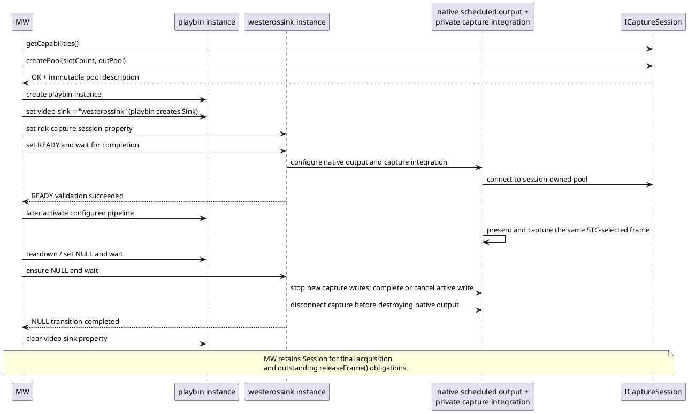

# SoC Video Frame Capture Specification

**Status:** Draft for review.

**Specification version:** 0.6

## Revision history

| Version | Status | What changed | What reviewers should check |
|---|---|---|---|
| 0.6 | Draft for review | Changed ICaptureSession delivery from GstContext to Gst property based on feedback that GstContext is pipeline-wide, not element-specific. Added westeros-sink-soc.h contract changes for property handling. Uprev to v0.6. | Property-based delivery approach, westeros-sink-soc.h contract changes, property cons and mitigations, Section 6 removal |
| 0.5 | Draft for review | Added ICaptureSession delivery mechanism documentation, clarifying comments to Westeros example showing platform-dependent factory selection, and factory function example. No API contract changes. | Delivery mechanism documentation, example clarity, and version bump. |
| 0.4 | Draft for review | Kept the existing platform video sink as playbin's selected sink, supplied the capture session directly to that sink, permitted direct or private-helper capture integration, and added sink-compatibility checks. | Existing-sink association, context handling, scheduled-output attachment, preservation of normal sink behavior and properties, reference ownership, teardown, and integration tests. |
| 0.3 | Draft for review | Expanded frame representation and acquisition safety, made pool and FD ownership explicit, and defined the complete per-pipeline GStreamer integration with construction and test examples. | Plane/object layout, acquisition tokens, failure invariants, process-local FD ownership, pool provisioning, playbin/session association, reference ownership, teardown, and conformance tests. |
| 0.2 | Draft for review | Changed frame acquisition so the HAL returns each newly selected frame once instead of repeatedly returning the same slot. Clarified that several previously returned frames may remain locked at the same time. | Frame acquisition and release, behavior when there is no newer frame, slot exhaustion, flush, and teardown. |
| 0.1 | Initial draft | Introduced the capture session, DMA-BUF pool, GStreamer attachment, frame selection, and lifetime contract. | Complete specification. |

### What changed in version 0.6

- Changed ICaptureSession delivery from GstContext to Gst property based on feedback that GstContext is pipeline-wide, not element-specific.
- Added westeros-sink-soc.h contract changes for property handling, including required struct fields and contract function.
- Documented property cons and mitigations (permanent configuration implication, public API, namespace pollution).
- Removed Section 6 (conformance testing moved to Section 6.6).
- Uprev to v0.6.

### What changed in version 0.5

- Added documentation for ICaptureSession delivery mechanism, specifying that SoC vendor provides a shared library with a factory function.
- Added clarifying comments to the Westeros example in Section 6.5 to emphasize that the factory name is platform-dependent and supplied by the platform integration.
- Added factory function example in Section 6.3 showing how MW calls the vendor factory to obtain ICaptureSession.
- No API contract changes; interface signatures and method behaviors remain unchanged.

### What changed in version 0.4

- The normal platform policy resolves and creates the concrete video sink before `READY`; the same sink remains assigned to playbin's `video-sink` property.
- MW supplies the pipeline-local `ICaptureSession` directly to that sink through the `rdk-capture-session` property.
- The platform sink implements capture directly or owns a private helper attached to its native scheduled-output path while preserving normal presentation and the existing sink contract.
- The revision provides a complete MW lifecycle example, non-normative Westeros property plumbing, a runnable plumbing prototype requirement, and aligned conformance tests.

### What changed in version 0.3

- The pool keeps the indexed DMA-BUF object and plane layout introduced in 0.2, but no longer exports FDs at pool creation. Each successful acquisition exports one MW-process-local FD for every DMA-BUF object referenced by that slot.
- Each acquisition now carries a unique token. `releaseFrame()` validates the slot and token so a stale frame cannot release a newer lock after slot reuse.
- `CapturedFrame` is non-copyable and move-constructible, with deleted move assignment. FD ownership remains separate from the one required frame release.
- Failed HAL calls leave outputs unchanged, close descriptors created by the failed attempt, roll back temporary locks, and create no new caller obligation. Different slots cannot expose overlapping byte ranges.
- The previous explicit `gst_frame_capture_attach()`/`detach()` side channel is replaced by one explicitly selected `framecapture` video sink or sink-bin per playbin. A pipeline-local GObject property supplies that sink with its borrowed `ICaptureSession`.
- `createPool()` completes capacity and backing admission before GStreamer enters `READY`. `READY` validates compatibility and connects native scheduled output to the existing pool; it does not allocate another pool.
- MW takes ownership of the factory-created sink's floating reference before assigning it to playbin, then releases only its own reference after playbin retains the sink.
- Section 6 adds complete construction and rollback code plus a vendor integration-test template covering property validation, reference ownership, scheduled-output teardown, and concurrent-pipeline isolation.

### What changed in version 0.2

- `acquireCurrentFrame()` now returns `NO_NEW_FRAME` when the current scheduler selection has already been returned. In this case it does not change `outFrame` or create another lock.
- A successful acquisition still locks the returned slot. Different acquired frames may keep different slots locked concurrently until MW releases them.
- The HAL decides whether a frame is new from its scheduler state, not by comparing reusable slot indices.
- The flush, slot-exhaustion, pipeline-teardown, and late-release rules now follow the new acquisition behavior.
- The conformance checks now cover repeated and concurrent acquisition, multiple locked slots, slot reuse, and post-teardown release.

---

## 0. Contract boundary

This specification defines the in-process contract between **MW** and the **SoC vendor**:

```text
MW
 ├── knows the pipeline output requirement before graph construction
 ├── calls ICaptureSession and retains the returned pool description
 ├── supplies the session to the existing platform video sink
 └── owns returned FDs and matching frame releases

SoC vendor
 ├── implements ICaptureSession
 ├── integrates capture with the existing platform video sink
 └── connects its session-owned pool to native scheduled output
```

MW means the middleware component that calls the HAL. Transport and rendering after the HAL returns a frame are not part of this specification.

---

## 1. Purpose

This specification defines how the SoC vendor exposes decoded clear-video frames to MW.

`ICaptureSession` provisions the capture slots and tracks their ownership while frames are retained. The SoC vendor chooses how those slots are backed and supplied to the scheduled-output path.

This adds to the existing SoC decode stack; it does not replace it.

## 2. Roles and responsibilities

| Role | Definition | Responsibilities |
|------|------------|------------------|
| **MW** | The middleware that calls the HAL. | - Determines each pipeline's output requirement before graph construction<br>- Obtains one session and creates one pool for each capture-enabled pipeline<br>- Retains the returned immutable pool description<br>- Obtains the pipeline's existing platform video sink, sets its session property, and assigns that same sink to playbin<br>- Closes returned FDs and releases acquired frames<br>- Keeps the session alive until sink teardown and all releases are complete |
| **SoC vendor** | The provider of the decoder and capture implementation. | - Implements `ICaptureSession` and the advertised fixed layout<br>- Integrates capture with the existing platform video sink, directly or through a private helper<br>- Observes the native scheduled-output frame selection<br>- Uses the pool owned by the configured session<br>- Preserves normal presentation and the platform sink contract<br>- Exports FDs atomically and preserves locked frame contents<br>- Keeps decode, audio, STC, and scheduled selection running when capture slots are exhausted<br>- Tears down safely and accepts required late releases |

### 2.1 Vendor delivery information

For integration and review, the SoC vendor supplies:

1. the platform policy that selects the concrete video sink factory and that sink's supported input caps;
2. support for the `rdk-capture-session` GObject property on that sink;
3. a runnable plumbing prototype showing selection, property receipt before `READY`, playbin assignment, normal presentation, and teardown;
4. the concrete `CaptureCapabilities` values;
5. the fixed pool layout and supported slot counts;
6. evidence that pipeline-local association, native selection, locking, FD export, exhaustion, sink teardown, late release, normal presentation, and existing sink behavior meet this specification; and
7. any platform constraint that makes Video Frame Capture unsupported; and
8. **ICaptureSession delivery mechanism**: The SoC vendor provides a shared library with a factory function to create ICaptureSession instances. The factory function signature is:

```cpp
ICaptureSession* createCaptureSession(const CaptureConfig& config);
```

The library naming convention is platform-specific (e.g., `libcapture-<vendor>.so`). MW loads the library using the platform's normal library discovery mechanism (e.g., `dlopen()`), resolves the factory symbol, and calls it to obtain an ICaptureSession instance. The application retains ownership of the session and must destroy it (via the vendor-provided destruction function or by calling the factory's `destroyCaptureSession()` method) after the pipeline has reached NULL and all acquired frames have been released. The session lifetime must exceed the sink's READY state; the sink borrows the session pointer and does not take ownership.

9. **WesterosSinkSoC ICaptureSession integration**: The SoC vendor must extend their westeros-sink-soc.h contract to support ICaptureSession delivery via the `rdk-capture-session` GObject property as specified in Section 6.6. This includes:
   - Adding `captureSession` and `captureSessionEnabled` fields to `GstWesterosSinkSoc`
   - Implementing `gst_westeros_sink_soc_set_capture_session()`
   - Connecting capture during NULL→READY
   - Disconnecting capture during READY→NULL

The vendor also provides whatever private decoder or scheduled-output access the sink's capture integration needs. That access must not interfere with native scheduling, STC progression, audio presentation, normal playback, sink properties, decoder discovery, subtitle integration, or secondary-video behavior.

## 3. Scope

### What this specification defines

- The capture session and fixed pool layout.
- Association with native scheduled output and its frame selection.
- Frame-plane, DMA-BUF object, crop, format, modifier, and timestamp metadata.
- Atomic frame acquisition, FD ownership, frame locks, and release.
- Synchronization, slot exhaustion, sink teardown, and late release.

### 3.1 Terminology

The contract uses these terms exclusively:

| Term | Meaning |
|---|---|
| **Current selection** | The frame chosen by native scheduled output for the current STC/display position. |
| **Frame** | The current selection's timestamp, visible region, slot, and exported FDs. One successful acquisition creates one frame lock. |
| **Slot layout** | The fixed plane layout for one reusable pool slot. |
| **Frame plane** | One DRM image plane and its byte range and stride within a DMA-BUF object. It owns no FD. |
| **DMA-BUF object** | One DMA-BUF allocation. One object may back one or more planes or slots. |
| **Exported DMA-BUF** | One valid raw FD in the MW process for a DMA-BUF object. On successful acquisition, ownership has transferred to MW; `fd >= 0` is owned and must be closed, and `-1` is invalid. The FD is not a frame lock. |
| **Pool** | The concrete slot reservation owned by one session. `CapturePool` is MW's immutable description of its DMA-BUF object metadata and slot layouts; the description contains no FDs. |

The document does not use “buffer” as a synonym for either slot or frame. “Decoder output buffer” is used only when referring to a vendor-native object outside the capture-pool contract.

### 3.2 Conceptual model

The relationships are directional and do not imply one-to-one cardinality:

```
Frame (selected content and timing)
  └── Slot layout
       ├── Frame plane 0 ──references──> DMA-BUF object A ──exported as──> FD for A
       ├── Frame plane 1 ──references──> DMA-BUF object A ──same object, no second FD
       └── Frame plane 2 ──references──> DMA-BUF object B ──exported as──> FD for B
```

- A **Frame** is decoded content written to one reusable slot at a specific STC selection.
- Its **slot layout** contains one logical record for each DRM plane.
- Each **frame plane** references exactly one **DMA-BUF object** and describes its byte range and stride within that allocation.
- Several planes may reference the same object at different offsets, or each plane may reference a different object. Mixed arrangements are valid.
- A successful acquisition exports one FD for each distinct object referenced by the selected slot, never one FD per plane by implication.
- The process-local FD value is not object identity. `dmaBufObjectIndex` is the join key between plane layout and exported handle records.

## 4. Mandatory ownership model

The following behavior is normative; the allocation strategy is an SoC vendor decision:

> `ICaptureSession` provisions the capture slots and owns their retention/lock state. The SoC vendor may back them with decoder DPB buffers, a separate capture pool, or another implementation. Regardless of strategy, a locked slot's contents must remain valid and must not be overwritten until its matching `releaseFrame()`. Pipeline teardown must not invalidate an outstanding acquired frame; resources needed to complete its late release remain valid until the session is closed.

MW owns the session from the caller side and releases each acquired frame exactly once. The SoC vendor owns the slot state and backing implementation.

The decoder and capture path must not overwrite a locked slot or invalidate an acquired frame during teardown. Capture-slot exhaustion must not block decode, native scheduled selection, audio presentation, or STC progression. The backing strategy is a vendor choice.

FD lifetime and frame-content lifetime are separate. MW owns and explicitly closes every FD returned by a successful acquisition. Closing an FD does not release the frame lock, and an open FD does not preserve stable contents after release. MW completes every downstream use before calling `releaseFrame()`; after release, it must not access that frame and the SoC may reuse the slot.

A successful acquisition also guarantees that decoder writes, cache maintenance, and SoC-side synchronization are complete, so the selected slot is safe to read. The HAL returns no graphics fence. MW completes downstream use before release, while any decoder, capture, cache, or native fence handling remains private to the SoC implementation.

## 5. Session lifecycle and selection state

### 5.1 Pipeline-scoped lifetime

MW knows whether a pipeline requires frame capture before graph construction. Each capture-enabled pipeline has one dedicated `ICaptureSession` and one session-owned pool. MW provisions that pool before the GStreamer integration in Section 6 and retains its immutable description as defined by `createPool()` in Section 8.

A session belongs to one pipeline and is never reassociated or reused. Its lifetime extends beyond sink teardown until the final acquisition opportunity is resolved or abandoned and every acquired frame is released.

### 5.2 Selection state

The session passively tracks the native STC scheduler's current captured selection, whether that selection has already been acquired, and every active frame lock. Selection identity is independent of reusable slot identity: a released slot may later hold a different selection that returns `OK` once.

A slot is writable only when it has no frame lock and no write in progress. Before reusing an unlocked current slot, the session atomically invalidates the old selection so concurrent acquisition returns `NO_FRAME` rather than observing an overwrite. Section 6.4.1 defines scheduler-state behavior; Section 8 defines acquisition and release semantics.

### 5.3 Post-teardown behavior

The platform sink first completes the disconnection contract in Section 6.4.2. The session, final current selection, and locked slots then remain valid while MW completes these obligations:

1. An unacquired final selection remains available once; transient `NO_RESOURCES` leaves it available for retry.
2. An already acquired final selection returns `NO_NEW_FRAME`, and no valid final selection returns `NO_FRAME`.
3. The session continues accepting `releaseFrame()` for every acquired frame, whose contents remain valid until release.
4. MW destroys the session only after the final acquisition opportunity is resolved or abandoned and every frame lock is released.

The selection does not advance after sink teardown.

## 6. GStreamer integration and scheduled-output behavior

### 6.1 Required integration model

The platform video sink is westerossink. MW creates the playbin instance, sets its `video-sink` property to "westerossink" (which causes playbin to create the westerossink instance), sets the `rdk-capture-session` property on the westerossink instance, and drives it to READY to validate capture integration. Capture integrates with the existing surface and video-plane output.

The platform sink integrates capture directly or owns a private helper attached to its native scheduled-output path. The helper may be a private object or child GStreamer element. The public pipeline topology remains unchanged.

For every returned frame, the vendor implementation uses the same STC and scheduling rules as native scheduled output. It publishes only a selection established after decoder consumption. `CapturedFrame.presentationTimeNs` is the selected frame's PTS in that scheduler timeline.

Capture preserves normal presentation and the platform sink's existing contract, including its properties, surface output, decoder discovery, subtitle integration, secondary-video behavior, and scheduling. A pipeline not requesting capture uses the same platform sink without a capture session and is otherwise unaffected.

Each capture-enabled pipeline has one independent relationship:

```text
playbin instance
  -> westerossink instance
       -> capture integration (direct or private helper)
            -> ICaptureSession
                 -> session-owned capture pool
```

Concurrent or dual video uses one complete relationship per pipeline. Sink A receives session A and can access only pool A; sink B receives session B and can access only pool B. The SoC implementation does not choose among active playbins. If a vendor-private graph contains multiple scheduled-output branches, the platform sink associates the session with the exact branch represented by that sink instance.

### 6.2 Session-property contract

The property name is `rdk-capture-session` with type G_TYPE_POINTER and value type `ICaptureSession *`. The pointer is opaque to GStreamer and borrowed by the sink. MW keeps it valid until sink teardown completes and retains the session longer when final acquisition or late release remains possible.

MW sets the property directly on the westerossink instance before any state transition that can start decoder output. The sink accepts exactly one non-null session. Reapplying the same pointer is idempotent; a null pointer or attempt to replace it with a different session is invalid.

Before entering `READY`, the sink validates that `createPool()` completed successfully and that its native scheduled output and capture integration are compatible with that session-owned pool. `READY` does not allocate or reserve pool backing. Invalid configuration or incompatible setup makes the transition fail with a GStreamer error, rolls back partial capture setup, and starts no capture writes.

The property does not own the session, create a pool, or carry the `CapturePool` description. Private access to backing and scheduler state remains inside the paired vendor implementations.

### 6.3 WesterosSinkSoC contract

Each SoC-specific `westeros-sink-soc.h` must extend the `GstWesterosSinkSoc` struct with the following fields:

```cpp
struct _GstWesterosSinkSoc
{
    // ... existing fields ...

    // ICaptureSession support
    void *captureSession;              // Borrowed ICaptureSession pointer
    gboolean captureSessionEnabled;   // Whether capture session is active
};
```

Each SoC-specific `westeros-sink-soc.c` must implement the following contract function:

```cpp
gboolean gst_westeros_sink_soc_set_capture_session(
    GstWesterosSink *sink,
    void *session);
```

**Semantics**:
- Input: `sink` - WesterosSink instance, `session` - ICaptureSession pointer (borrowed, not owned)
- Return: TRUE if session accepted, FALSE if rejected
- Must validate that session is non-null
- Must store session in `sink->soc.captureSession`
- Must set `sink->soc.captureSessionEnabled = TRUE`
- Must reject if session is already set (idempotent: reapplying same session is OK, different session is error)

The common `westeros-sink.c` must implement a property handler for `rdk-capture-session`:

```cpp
static void gst_westeros_sink_set_property(GObject *object, guint prop_id, const GValue *value, GParamSpec *pspec)
{
    GstWesterosSink *sink = GST_WESTEROS_SINK(object);

    switch (prop_id)
    {
        case PROP_RDK_CAPTURE_SESSION:
        {
            gpointer session = g_value_get_pointer(value);
            if (!gst_westeros_sink_soc_set_capture_session(sink, session))
            {
                GST_ERROR_OBJECT(sink, "Failed to set capture session");
            }
            break;
        }
        default:
            G_OBJECT_WARN_INVALID_PROPERTY_ID(object, prop_id, pspec);
            break;
    }
}
```

The property must be registered in the class_init function.

**Timing requirements**:
- **Connect**: During NULL→READY, after pool creation and before decoder starts, in `gst_westeros_sink_soc_null_to_ready()`
- **Disconnect**: During READY→NULL, before decoder teardown, in `gst_westeros_sink_soc_ready_to_null()`

This timing matches Section 6.2: READY validates compatibility and connects native scheduled output to the existing pool.

**Session lifetime**: The ICaptureSession pointer is borrowed by the sink. MW keeps it valid until sink teardown completes and retains the session longer when final acquisition or late release remains possible. The sink does not take ownership of the session.

### 6.4 Middleware lifecycle

The complete construction and teardown order is:



The application selects Video Frame Capture through its media API before pipeline construction. It does not manipulate GStreamer objects or pass `ICaptureSession` directly. MW performs the integration using one session and the westerossink instance.

MW creates the playbin instance, sets its `video-sink` property to "westerossink" (which causes playbin to create the westerossink instance), sets the `rdk-capture-session` property on the westerossink instance, then drives it to READY to validate capture integration. Success proves that the sink accepted the property, validated compatibility, and connected its capture integration to the pool already created by `session.createPool()`. It does not claim that playbin has prerolled or activated a media source.

The caller retains `session` and `outPool` after success. `outPool` is used to interpret acquired frames; it is not passed to the sink. A failure after `createPool()` returns the sink to `NULL`. The pool remains owned by the session, so the caller discards that session and creates a fresh one for any retry.

Pipeline teardown takes playbin to `NULL`, which destroys the westerossink instance. MW retains the session until teardown completes, the final acquisition opportunity is resolved, and every acquired frame has been released.

**Obtaining ICaptureSession from vendor library**: MW loads the vendor-provided shared library using the platform's normal library discovery mechanism (e.g., `dlopen()`), resolves the factory symbol, and calls it to obtain an ICaptureSession instance. The application retains ownership of the session and must destroy it after the pipeline has reached NULL and all acquired frames have been released.

### 6.5 Prototype and conformance testing

A vendor can use the same helper shape with a test `ICaptureSession` and an instrumented westerossink. At minimum, an integration test verifies:

```cpp
TEST(FrameCaptureIntegration, PreservesPlatformSinkAndAssociatesSession)
{
    TestCaptureSession session;
    GstElement *playbin = gst_element_factory_make("playbin", nullptr);
    CapturePool pool;

    ASSERT_NE(playbin, nullptr);

    ASSERT_TRUE(configureFrameCaptureOutput(
        playbin, session, 4, pool));

    GstElement *configuredSink = nullptr;
    g_object_get(playbin, "video-sink", &configuredSink, nullptr);
    ASSERT_NE(configuredSink, nullptr);
    ASSERT_STREQ(GST_ELEMENT_NAME(configuredSink), "westerossink");

    EXPECT_EQ(session.createPoolCallCount(), 1u);
    EXPECT_EQ(session.requestedSlotCount(), 4u);
    EXPECT_EQ(testCaptureSession(configuredSink), &session);
    EXPECT_TRUE(testScheduledOutputConnected(configuredSink));
    EXPECT_TRUE(testNormalPresentationActive(configuredSink));
    EXPECT_TRUE(existingSinkPropertiesUnchanged(configuredSink));

    ASSERT_TRUE(teardownFrameCaptureOutput(playbin));

    gst_object_unref(configuredSink);
    gst_object_unref(playbin);
}
```

The test functions are vendor test hooks, not production APIs. Additional tests create two playbins with two westerossink instances and two sessions and verify that each sink reaches only its own session and pool. Failure tests cover null session property, repeated property with a different session, incompatible `READY` setup, and rollback to `NULL` without capture writes.

The vendor supplies a runnable plumbing prototype using westerossink or an instrumented build of westerossink. The prototype demonstrates property receipt on the westerossink instance before `READY`, successful `READY` validation, assignment to playbin, normal presentation, and confirmed `NULL` teardown. It need not implement frame export while validating this plumbing.

The integration suite also verifies that normal scheduled presentation continues while capture is enabled; existing sink properties retain their values and effects; decoder discovery, subtitle integration, secondary-video behavior, geometry, visibility, and immediate-output behavior remain usable; capture-slot exhaustion omits capture without blocking presentation; and teardown disconnects capture before scheduled output is destroyed. Final acquisition and late `releaseFrame()` remain valid after sink teardown.


## 7. Capture value types

```cpp
enum class CaptureStatus : uint32_t
{
    OK,
    NO_NEW_FRAME,
    UNSUPPORTED,
    INVALID_ARGUMENT,
    NO_RESOURCES,
    NO_FRAME,
    FATAL_ERROR,
};

constexpr uint32_t kInvalidCaptureSlotIndex = std::numeric_limits<uint32_t>::max();
constexpr uint64_t kInvalidAcquisitionToken = 0;

struct Size
{
    uint32_t width;
    uint32_t height;
};

struct Rectangle
{
    uint32_t x;
    uint32_t y;
    Size size;
};

struct CaptureCapabilities
{
    uint32_t size{sizeof(CaptureCapabilities)};
    uint32_t drmFormat;
    uint64_t drmModifier;
    Size maximumContentSize;
    uint32_t maximumSlots;
};

struct DmaBufObject
{
    uint32_t objectIndex;
    uint64_t sizeBytes;
};

struct FramePlane
{
    uint32_t planeIndex;
    uint32_t dmaBufObjectIndex;
    uint64_t offsetBytes;
    uint64_t lengthBytes;
    uint32_t strideBytes;
};

struct CaptureSlotLayout
{
    uint32_t slotIndex;
    std::vector<FramePlane> planes;
};

struct ExportedDmaBuf
{
    uint32_t dmaBufObjectIndex;
    int fd{-1};
};

struct CapturePool
{
    Size backingSize;
    std::vector<DmaBufObject> dmaBufObjects;
    std::vector<CaptureSlotLayout> slotLayouts;
};

struct CapturedFrame
{
    uint32_t slotIndex{kInvalidCaptureSlotIndex};
    uint64_t acquisitionToken{kInvalidAcquisitionToken};
    int64_t presentationTimeNs;
    Rectangle visibleRegion;
    std::vector<ExportedDmaBuf> exportedDmaBufs;

    CapturedFrame() : presentationTimeNs{0}, visibleRegion{} {}
    CapturedFrame(const CapturedFrame &) = delete;
    CapturedFrame &operator=(const CapturedFrame &) = delete;
    CapturedFrame(CapturedFrame &&other) noexcept;
    CapturedFrame &operator=(CapturedFrame &&other) noexcept = delete;
    ~CapturedFrame() = default;
};
```

The value types follow these rules:

- `backingSize` describes the capacity of each logical slot; it does not require a particular physical allocation strategy.
- MW owns each successful `fd >= 0`, closes it explicitly, and sets it to `-1`. `-1` means invalid. Destructors do not close FDs.
- `CapturedFrame` is non-copyable. A valid `slotIndex` and matching `acquisitionToken` mean exactly one `releaseFrame()` is owed, independently of FD ownership.
- The HAL assigns a unique non-zero `acquisitionToken` for each successful acquisition. The token is opaque; MW must not interpret or reconstruct it.
- Moving a frame through the move constructor transfers its metadata, FDs, token, and release obligation without `dup()` or `close()`. The source FDs become `-1`, its `slotIndex` becomes `kInvalidCaptureSlotIndex`, and its `acquisitionToken` becomes `kInvalidAcquisitionToken`.
- Move assignment is deleted to avoid undefined behavior when the destination is non-empty. To reuse an existing instance, callers must release its frame lock, close and invalidate its FDs, return it to the empty state, and pass it to `acquireCurrentFrame()`; transferring ownership to a different object requires the move constructor.
- Pool `slotIndex` and `objectIndex` values equal their positions in `slotLayouts` and `dmaBufObjects`. They are unique and contiguous from zero; no pool slot may use `kInvalidCaptureSlotIndex`.
- `planeIndex` follows the plane order defined by the reported DRM format. Import code maps that order to its graphics API.
- Each plane references one valid object. Validate its range without overflow: `offsetBytes <= sizeBytes` and `lengthBytes <= sizeBytes - offsetBytes`. The range and stride must fit the advertised layout.
- For any two planes that belong to different slots and reference the same DMA-BUF object, their half-open byte ranges `[offsetBytes, offsetBytes + lengthBytes)` must not overlap. Planes within one slot may share an object as defined by that format, but storage exposed by different slots is disjoint.
- For every `OK` frame, validate `visibleRegion` without overflow: `x <= backingSize.width`, `size.width <= backingSize.width - x`, `y <= backingSize.height`, and `size.height <= backingSize.height - y`.
- Plane and object metadata remain fixed for the pool lifetime. Storage not exposed as a DRM plane remains part of its DMA-BUF object.
- On `OK`, `exportedDmaBufs` contains exactly one entry for each distinct object referenced by the selected slot, with no duplicate or unrelated object. Object index—not FD value—is the join key.

Plane count, object count, and FD count are independent.

A `CapturedFrame` is empty only when its `slotIndex` is invalid, its `acquisitionToken` is invalid, and every FD is `-1`. Closing all FDs does not make a frame empty while its slot index and token remain valid; the frame lock still requires release.

FDs are exported only when a frame is acquired. MW owns and closes them. Closing an FD does not release the frame lock, and `releaseFrame()` does not inspect FD values.

### 7.1 Valid frame representations

The following examples use illustrative process-local FD values. Each object appears once in `dmaBufObjects`; each successful acquisition exports each referenced object once.

**Example A — one plane, one object, one FD**

```text
plane 0 ──> object 0 ──> FD 10
```

```cpp
dmaBufObjects = {{.objectIndex = 0, .sizeBytes = S}};
planes = {{.planeIndex = 0, .dmaBufObjectIndex = 0,
           .offsetBytes = 0, .lengthBytes = S, .strideBytes = P}};
exportedDmaBufs = {{.dmaBufObjectIndex = 0, .fd = 10}};
```

**Example B — two planes sharing one object and one FD**

```text
plane 0 ──> object 0 @ offset 0 ──> FD 10
plane 1 ──> object 0 @ offset N ──> same FD 10
```

```cpp
dmaBufObjects = {{.objectIndex = 0, .sizeBytes = S}};
planes = {
    {.planeIndex = 0, .dmaBufObjectIndex = 0,
     .offsetBytes = 0, .lengthBytes = N, .strideBytes = P0},
    {.planeIndex = 1, .dmaBufObjectIndex = 0,
     .offsetBytes = N, .lengthBytes = S - N, .strideBytes = P1},
};
exportedDmaBufs = {{.dmaBufObjectIndex = 0, .fd = 10}};
```

**Example C — two planes, two objects, two FDs**

```text
plane 0 ──> object 0 ──> FD 10
plane 1 ──> object 1 ──> FD 11
```

```cpp
dmaBufObjects = {
    {.objectIndex = 0, .sizeBytes = S0},
    {.objectIndex = 1, .sizeBytes = S1},
};
planes = {
    {.planeIndex = 0, .dmaBufObjectIndex = 0,
     .offsetBytes = 0, .lengthBytes = S0, .strideBytes = P0},
    {.planeIndex = 1, .dmaBufObjectIndex = 1,
     .offsetBytes = 0, .lengthBytes = S1, .strideBytes = P1},
};
exportedDmaBufs = {
    {.dmaBufObjectIndex = 0, .fd = 10},
    {.dmaBufObjectIndex = 1, .fd = 11},
};
```

**Example D — shared and separate objects in one frame**

```text
plane 0 ──> object 0 @ offset 0 ──> FD 10
plane 1 ──> object 0 @ offset N ──> same FD 10
plane 2 ──> object 1 @ offset 0 ──> FD 11
```

```cpp
dmaBufObjects = {
    {.objectIndex = 0, .sizeBytes = S0},
    {.objectIndex = 1, .sizeBytes = S1},
};
planes = {
    {.planeIndex = 0, .dmaBufObjectIndex = 0,
     .offsetBytes = 0, .lengthBytes = N, .strideBytes = P0},
    {.planeIndex = 1, .dmaBufObjectIndex = 0,
     .offsetBytes = N, .lengthBytes = S0 - N, .strideBytes = P1},
    {.planeIndex = 2, .dmaBufObjectIndex = 1,
     .offsetBytes = 0, .lengthBytes = S1, .strideBytes = P2},
};
exportedDmaBufs = {
    {.dmaBufObjectIndex = 0, .fd = 10},
    {.dmaBufObjectIndex = 1, .fd = 11},
};
```

### 7.2 DRM NV12 linear example

For this example, `CaptureCapabilities` reports `DRM_FORMAT_NV12` and `DRM_FORMAT_MOD_LINEAR`; the pool supplies the plane/object layout shown below. Linux `drm_fourcc.h` defines NV12 as a two-plane format and the modifier as linear storage. An NV12 slot may represent plane 0 (luma Y) and plane 1 (interleaved chroma UV) using either Example B, where both planes reference one DMA-BUF object at different offsets and acquisition exports one FD, or Example C, where each plane references a separate object and acquisition exports two object-indexed FDs. The modifier does not determine DMA-BUF object or FD cardinality; the plane-to-object mapping in the slot layout does. These examples define representational capability, while an implementation must still advertise and provide an arrangement importable through every required graphics path.

### 7.3 Fixed capture layout

Each implementation supports one fixed capture contract. `getCapabilities()` reports its format, modifier, and limits. `createPool()` reports the concrete object, slot, and plane layout. The two records belong to the same session and together describe the layout; neither duplicates the other's fields.

The implementation need not support every shared-object, separate-object, or mixed arrangement shown in the examples. Its returned pool must faithfully represent its one fixed format/modifier arrangement and be usable through every required graphics path.

For the requested slot count, `CapturePool` describes:

- the actual logical slot capacity in `backingSize`;
- each DMA-BUF object's index and size; and
- each slot's indexed planes, object references, offsets, lengths, and strides.

Every slot supports `backingSize`; that size must not exceed `maximumContentSize`. `slotLayouts.size()` equals the requested count, which must not exceed `maximumSlots`. For each DMA-BUF object, `createPool()` must validate that no byte range referenced by one slot overlaps a byte range referenced by another slot. A pool with cross-slot overlap is invalid and must not be returned as `OK`.

The capability values and concrete pool layout remain fixed until the session is closed. Resolution or crop changes update `CapturedFrame.visibleRegion`; they do not replace the slot reservation.

If content exceeds `CaptureCapabilities.maximumContentSize` or cannot be represented by the implemented capture layout, capture returns `UNSUPPORTED` or `FATAL_ERROR` and stops updating its current selection. It does not silently disable capture while continuing only normal platform-sink output; MW chooses any later pipeline reconstruction. Unrelated normal-output pipelines remain available. Runtime capture-slot replacement is outside this specification. One `ICaptureSession` has one logical slot reservation for its complete lifetime.

## 8. Session interface

```cpp
class ICaptureSession
{
public:
    virtual ~ICaptureSession() = default;

    virtual CaptureStatus getCapabilities(CaptureCapabilities &out) const = 0;

    virtual CaptureStatus createPool(
        uint32_t slotCount,
        CapturePool &outPool) = 0;

    virtual CaptureStatus acquireCurrentFrame(
        CapturedFrame &outFrame) = 0;

    virtual CaptureStatus releaseFrame(
        CapturedFrame &frame) = 0;
};
```

`getCapabilities()` reports exactly the fixed `drmFormat`, `drmModifier`, `maximumContentSize`, and `maximumSlots` for the session. It does not report plane count/order, DMA-BUF objects, plane mappings, offsets, lengths, strides, or actual pool backing size. `OK` fully populates `out`; every non-`OK` result leaves it unchanged.

`createPool()` accepts `slotCount` only when `slotCount > 0` and `slotCount <= maximumSlots`; otherwise it returns `INVALID_ARGUMENT` and leaves `outPool` unchanged. The call may complete successfully only once per session; a later call returns `INVALID_ARGUMENT`. On `OK`, it synchronously provisions the requested session-owned slot capacity and every backing/resource reservation required for the sink to enter `READY` and capture into those slots. It returns the concrete immutable pool layout: `backingSize`, DMA-BUF object indices/sizes, and each slot's plane indices, object references, offsets, lengths, and strides. It does not repeat format or modifier and contains no FDs. Every plane range must pass the overflow-safe validation in Section 7. `backingSize` must not exceed `maximumContentSize`, and the returned layout must be valid for the same session's format and modifier. Every non-`OK` result leaves `outPool` unchanged, releases partial provisioning, and creates no pool.

The capability result and pool belong to the same session and are interpreted together. Format, modifier, and limits remain fixed for that session. MW keeps both records while it needs to interpret the pool; no extra capability fields or duplicated pool fields are implied.

The SoC vendor chooses how to provide the slots. `maximumSlots` is the greatest count that preserves the resources needed for normal playback.

`acquireCurrentFrame()` requires an empty `outFrame`: `slotIndex == kInvalidCaptureSlotIndex`, `acquisitionToken == kInvalidAcquisitionToken`, and every `ExportedDmaBuf.fd == -1`. These are the exact empty-state conditions defined in Section 7; any other FD value, including a negative value other than `-1`, is non-empty. A valid slot index and matching token mean that output still owes a release even if all its FDs are already closed and set to `-1`. Passing a non-empty output returns `INVALID_ARGUMENT` without changing it.

For an empty output, the method examines the current native selection. A new selection is temporarily locked, all required FDs are exported, and the complete result—including the valid slot index and release obligation—is moved into `outFrame` before returning `OK`. Every returned FD is valid in the MW process, is independently owned by MW before the call returns, and remains valid if the vendor implementation closes any descriptor from which it was obtained. The vendor may obtain, duplicate, export, or transport the descriptor through in-process or vendor-service-specific mechanisms; those mechanisms and their descriptor lifetimes are private and are not part of this interface. No valid selection returns `NO_FRAME`; an already returned selection returns `NO_NEW_FRAME`. Every non-`OK` result leaves `outFrame` unchanged and creates no release obligation.

If descriptor creation/export fails because a transient resource is unavailable, including descriptor exhaustion, `acquireCurrentFrame()` returns `NO_RESOURCES`. Before returning, the vendor implementation explicitly closes every FD created for that attempt, removes the temporary lock, leaves the selection not returned, and does not move any result into `outFrame`. No matching release is required and the selection remains retriable. An unrecoverable session/backing failure returns `FATAL_ERROR` with the same all-or-nothing cleanup. `FATAL_ERROR` is not retriable; capture is unavailable for the remainder of the session. An implementation that cannot roll back atomically is non-conformant.

`createPool()` is the synchronous provisioning point for the session-owned slots and the backing/resource capacity represented by `outPool`. After it returns `OK`, sink validation at `READY` must not require another fallible pool allocation or reservation step. This does not pre-create or export caller-owned DMA-BUF FDs: for each successful acquisition, `acquireCurrentFrame()` creates/exports the FD handles needed to access the selected slot's DMA-BUF objects. A vendor may map a selected native allocation into a reserved logical slot when that scheduler selection is captured and crystallize/export its handles only at acquisition, but the capacity and fixed layout were already admitted by `createPool()`. No newly created caller-owned FD handles from a failed attempt survive any non-`OK` result; any pre-existing value in `outFrame` remains the caller's unchanged responsibility.

On `OK`, MW owns every descriptor in `outFrame.exportedDmaBufs` and must close each one explicitly. Descriptor closure neither releases nor satisfies the HAL frame lock. The lock protects frame contents until the caller invokes the one matching `releaseFrame()` after all use has ended.

The SoC implementation determines whether a native scheduler selection is new using private scheduler identity or equivalent internal state, not `slotIndex`; a released slot may later contain a different selection. The new-selection check, temporary lock, complete descriptor export, returned-state commit, and move into `outFrame` form one atomic success transaction. A failed attempt rolls back and does not consume the selection. Later acquisition of the same current selection returns `NO_NEW_FRAME`. Reset, flush, seek, or equivalent decoder/scheduled-output processing may invalidate the current selection and comparison state without releasing acquired frames; acquisition then returns `NO_FRAME` until decoder consumption establishes another native selection.

Every `OK` acquisition establishes one lock for one distinct captured selection. Several acquired frames may lock different slots concurrently, but there is at most one live lock per slot and one successful acquisition per selection. MW may share access through references or one shared owner around the non-copyable record and calls `releaseFrame()` once when final use ends.

`releaseFrame(CapturedFrame &frame)` requires a valid slot index and a matching acquisition token. The HAL validates that the token corresponds to the current lock for that slot; a mismatched token indicates a stale or reconstructed frame and returns `INVALID_ARGUMENT`. On `OK`, it releases that slot lock and sets `frame.slotIndex` to `kInvalidCaptureSlotIndex` and `frame.acquisitionToken` to `kInvalidAcquisitionToken`. It does not inspect or close FDs, so MW must still close any open FDs separately. A successful release makes the frame invalid for content access even if an FD remains open.

An invalid, moved-from, out-of-range, stale, or currently unlocked slot index, or a mismatched acquisition token, returns `INVALID_ARGUMENT`. Every non-`OK` result leaves both the frame and its existing lock state unchanged, so a valid frame retains exactly one release obligation. A slot cannot be reused while its lock remains active.

The **SoC vendor** supplies both `ICaptureSession` and the GStreamer integration. Scheduler notifications, writable-slot management, decoder handles, and copy/conversion details remain private between those components.

Capture has no independent start/stop state or selection policy. It follows valid native scheduler selections after decoder consumption. A valid selection remains acquirable while scheduled output is paused at stationary STC; a state transition alone does not manufacture or advance one.

No factory is implied by this interface.

## 9. Conformance checklist

An SoC implementation is conformant only when all of the following are true:

| Area | Requirement | Sections |
|---|---|---|
| Delivery and association | MW creates playbin, sets its `video-sink` property to "westerossink" (which creates the westerossink instance), and sets the `rdk-capture-session` property on it before driving to READY. MW supplies exactly one pipeline-local session property directly to that sink before state transition. Capture is implemented directly in the sink or by a private helper attached to its scheduled-output path. | §6 |
| Plumbing prototype | A runnable prototype proves property receipt on westerossink before `READY`, assignment to playbin, normal presentation, existing property behavior, and confirmed `NULL` teardown. | §6 |
| Concurrent pipelines | Each concurrent pipeline has a distinct westerossink instance, session, and session-owned pool. No sink can access or publish selections through another pipeline's session. | §§5, 6 |
| Capabilities and pool | `createPool()` synchronously provisions session-owned slot capacity and every required backing/resource reservation, then returns its concrete immutable, bounds-checked object/slot/plane description. READY validation performs no second pool allocation. Different slots have no overlapping ranges in one DMA-BUF object. The description is not passed back through the sink property, and caller-owned FDs are exported only at acquisition. | §§6–8 |
| Native selection | Capture follows the same native scheduled-output selection used for normal presentation. It returns `NO_FRAME` without a valid selection, `OK` once for a new selection, and `NO_NEW_FRAME` for a repeated selection. | §§5, 6, 8 |
| Existing sink contract | Capture preserves normal presentation, sink properties, surface output, decoder discovery, subtitle integration, secondary-video behavior, geometry, visibility, immediate-output behavior, and scheduling. | §6 |
| Frame identity, FD ownership and rollback | Valid slot identity and matching acquisition token mean one release is owed. Move constructor transfers token, slot index, and FDs, invalidating the source. HAL assigns unique non-zero token per acquisition. Acquisition requires invalid slot and token values and every FD exactly `-1`. Move assignment is deleted. MW closes one FD per distinct object. Export failure rolls back and leaves output unchanged. | §§4, 7, 8 |
| Frame locks and synchronization | One `OK` creates one lock. Successful release invalidates the slot identity but leaves FD ownership unchanged. Locked contents remain stable until MW completes use and releases the frame. | §§4, 5, 8 |
| Exhaustion and playback | Slot exhaustion may omit capture selections but must not stop decode, native scheduled selection, audio, or STC. | §§4–6 |
| Sink teardown | Final acquisition, transient retry, outstanding frame validity, late release, and session close follow the ordered teardown contract. Scheduled output is disconnected safely during sink state teardown. | §§5, 6 |
| Contract tests | Tests cover every area above, including missing/invalid/replaced session property, two concurrent pipelines without cross-association, preserved sink properties and presentation, invalid/default/moved/released frame identity, move constructor, acquisition token validation, acquisition-output reuse, capability/pool pairing, layout bounds and cross-slot non-overlap, rollback, repeated/concurrent acquisition, exhaustion, sink teardown, final acquisition, and late release. | — |

Failure of any mandatory gate means Video Frame Capture is unsupported on that implementation; it does not permit a weakened lifetime or playback-continuity contract.

