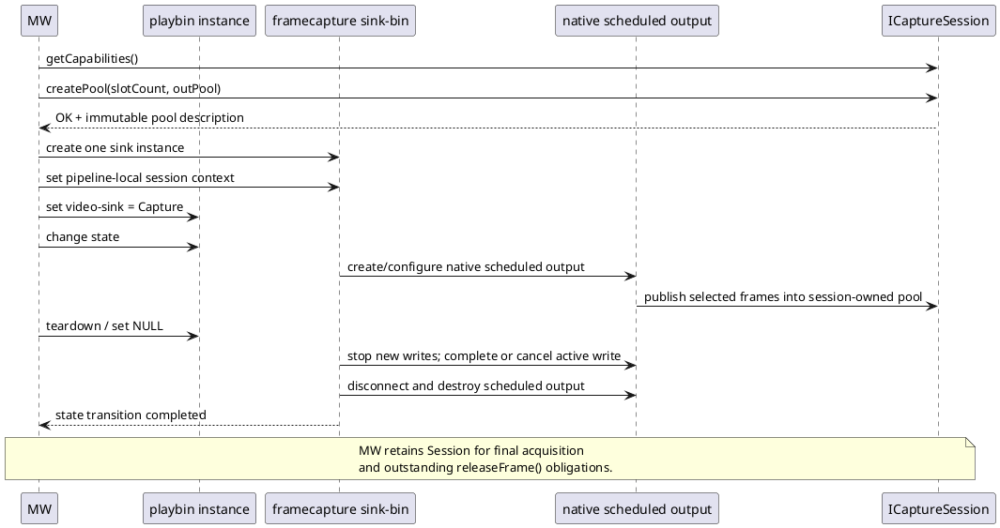

# SoC Video Frame Capture Specification

**Status:** Draft for review.

**Specification version:** 0.6

## Revision history

| Version | Status | What changed | What reviewers should check |
|---|---|---|---|
| 0.6 | Draft for review | Replaced the non-standard external integration model with explicit per-pipeline selection of a session-configured `framecapture` video sink or sink-bin. | Pipeline-local association, concurrent playback isolation, session context, sink construction failure, and teardown. |
| 0.5 | Draft for review | Added opaque acquisition token to `CapturedFrame` to prevent stale releases and prohibited overlapping DMA-BUF ranges between slots to preserve locked contents. | Acquisition token, token validation in `releaseFrame()`, move semantics, stale-release detection, and cross-slot layout isolation. |
| 0.4 | Draft for review | Deleted move assignment to avoid undefined contract-violation behavior; defined failure invariants for all CaptureStatus values; made `gst_frame_capture_detach()` infallible. | Move constructor only, failure invariants, detach contract, and conformance test updates. |
| 0.3 | Draft for review | Separated capability limits from concrete pool layout; defined explicit FD and frame-lock ownership, invalid lock identity, non-copyable/movable frame output, vendor playbin integration, native selection behavior, plane validation, and fixed-layout conformance. | Capability/pool pairing, move and release state, output reuse, FD ownership versus frame locks, native selection, attachment, teardown, and rollback. |
| 0.2 | Draft for review | Changed frame acquisition so the HAL returns each newly selected frame once instead of repeatedly returning the same slot. Clarified that several previously returned frames may remain locked at the same time. | Frame acquisition and release, behavior when there is no newer frame, slot exhaustion, flush, and teardown. |
| 0.1 | Initial draft | Introduced the capture session, DMA-BUF pool, GStreamer attachment, frame selection, and lifetime contract. | Complete specification. |

### What changed in version 0.6

- Pipeline requirements are known before GStreamer graph construction. A capture-enabled pipeline explicitly assigns one vendor `framecapture` sink or sink-bin to its playbin `video-sink` property.
- `framecapture` owns or contains the native scheduled-output implementation; it is not selected through factory rank and does not search for a current playbin.
- Each concurrent pipeline uses an independent sink instance, `ICaptureSession`, and session-owned pool.
- `createPool()` creates the concrete session-owned pool and returns its immutable description to MW; that description is not passed back to the sink.
- A pipeline-local `GstContext` associates the configured session with the sink before state transition. The previous external attach/detach API and separate `vendorVideoElement` argument are removed.
- `createPool()` is the single synchronous slot/backing provisioning point; READY performs compatibility validation without another pool allocation. Playbin retains the assigned sink, and MW drops its factory-created reference immediately after assignment.

### What changed in version 0.5

- Added `acquisitionToken` to `CapturedFrame`. The HAL assigns a unique non-zero token for each successful acquisition.
- `releaseFrame()` now validates both `slotIndex` and `acquisitionToken`. A mismatched token indicates a stale or reconstructed frame and returns `INVALID_ARGUMENT`.
- Move constructor transfers the token along with slot index and FDs; moved-from frame has invalid token.
- This prevents stale frames from releasing newer locks after slot reuse.
- Required byte ranges referenced by different slots in one DMA-BUF object to be non-overlapping, so writes to an unlocked slot cannot overwrite a locked slot.

### What changed in version 0.4

- Move assignment is deleted; only the move constructor is available. This avoids undefined behavior when move-assigning into a non-empty destination.
- Every non-`OK` result for `getCapabilities()`, `createPool()`, `acquireCurrentFrame()`, and `releaseFrame()` leaves the output unchanged and creates no new obligation. The invariant is stated explicitly for all status values.
- `gst_frame_capture_detach()` returns `void` and is infallible. Scheduled output is always safe to destroy after it returns.

### What changed in version 0.3

- Frame planes reference DMA-BUF objects by index; the API can represent shared-object and multi-object layouts.
- `getCapabilities()` reports format, modifier and limits; `createPool()` reports the concrete plane/object layout. Pool metadata contains no FDs.
- Acquisition exports one MW-owned FD for each distinct object referenced by the selected slot.
- `CapturedFrame` is non-copyable. Move transfers both FD ownership and the frame-release obligation; invalid slot identity means no release is owed.
- `getCapabilities()` returns `CaptureStatus` and leaves output unchanged on failure.
- The vendor pipeline integration creates and attaches `framecapture` to native scheduled output.
- Native selection, paused behavior, slot exhaustion, teardown, plane-range validation, and late release are fully defined.

### What changed in version 0.2

- `acquireCurrentFrame()` now returns `NO_NEW_FRAME` when the current scheduler selection has already been returned. In this case it does not change `outFrame` or create another lock.
- A successful acquisition still locks the returned slot. Different acquired frames may keep different slots locked concurrently until MW releases them.
- The HAL decides whether a frame is new from its scheduler state, not by comparing reusable slot indices.
- The flush, slot-exhaustion, pipeline-teardown, and late-release rules now follow the new acquisition behavior.
- The conformance checks now cover repeated and concurrent acquisition, multiple locked slots, slot reuse, and post-teardown release.

---

## 0. Contract boundary

This specification defines the in-process contract between **MW** and the **SoC vendor**:

```text
MW
 ├── knows the pipeline output requirement before graph construction
 ├── calls ICaptureSession and retains the returned pool description
 ├── selects framecapture for each capture-enabled playbin instance
 └── owns returned FDs and matching frame releases

SoC vendor
 ├── implements ICaptureSession
 ├── provides a playbin-compatible framecapture sink or sink-bin
 └── connects its session-owned pool to native scheduled output
```

MW means the middleware component that calls the HAL. Transport and rendering after the HAL returns a frame are not part of this specification.

---

## 1. Purpose

This specification defines how the SoC vendor exposes decoded clear-video frames to MW.

`ICaptureSession` provisions the capture slots and tracks their ownership while frames are retained. The SoC vendor chooses how those slots are backed and supplied to the scheduled-output path.

This adds to the existing SoC decode stack; it does not replace it.

## 2. Roles and responsibilities

| Role | Definition | Responsibilities |
|------|------------|------------------|
| **MW** | The middleware that calls the HAL. | - Determines each pipeline's output requirement before graph construction<br>- Obtains one session and creates one pool for each capture-enabled pipeline<br>- Retains the returned immutable pool description<br>- Creates one `framecapture` sink instance, supplies its session context, and assigns it to that playbin instance<br>- Closes returned FDs and releases acquired frames<br>- Keeps the session alive until sink teardown and all releases are complete |
| **SoC vendor** | The provider of the decoder and capture implementation. | - Implements `ICaptureSession` and the advertised fixed layout<br>- Provides and registers a playbin-compatible `framecapture` sink or sink-bin<br>- Owns or contains native scheduled output and follows its frame selection<br>- Uses the pool owned by the configured session<br>- Exports FDs atomically and preserves locked frame contents<br>- Keeps decode, audio, STC, and scheduled selection running when capture slots are exhausted<br>- Tears down safely and accepts required late releases |

## 3. Scope

### What this specification defines

- The capture session and fixed pool layout.
- Association with native scheduled output and its frame selection.
- Frame-plane, DMA-BUF object, crop, format, modifier, and timestamp metadata.
- Atomic frame acquisition, FD ownership, frame locks, and release.
- Synchronization, slot exhaustion, sink teardown, and late release.

### 3.1 Terminology

The contract uses these terms exclusively:

| Term | Meaning |
|---|---|
| **Current selection** | The frame chosen by native scheduled output for the current STC/display position. |
| **Frame** | The current selection's timestamp, visible region, slot, and exported FDs. One successful acquisition creates one frame lock. |
| **Slot layout** | The fixed plane layout for one reusable pool slot. |
| **Frame plane** | One DRM image plane and its byte range and stride within a DMA-BUF object. It owns no FD. |
| **DMA-BUF object** | One DMA-BUF allocation. One object may back one or more planes or slots. |
| **Exported DMA-BUF** | One MW-owned raw FD for a DMA-BUF object. `fd >= 0` is owned and must be closed; `-1` is invalid. The FD is not a frame lock. |
| **Pool** | The concrete slot reservation owned by one session. `CapturePool` is MW's immutable description of its DMA-BUF object metadata and slot layouts; the description contains no FDs. |

The document does not use “buffer” as a synonym for either slot or frame. “Decoder output buffer” is used only when referring to a vendor-native object outside the capture-pool contract.

### 3.2 Conceptual model

The relationships are directional and do not imply one-to-one cardinality:

```
Frame (selected content and timing)
  └── Slot layout
       ├── Frame plane 0 ──references──> DMA-BUF object A ──exported as──> FD for A
       ├── Frame plane 1 ──references──> DMA-BUF object A ──same object, no second FD
       └── Frame plane 2 ──references──> DMA-BUF object B ──exported as──> FD for B
```

- A **Frame** is decoded content written to one reusable slot at a specific STC selection.
- Its **slot layout** contains one logical record for each DRM plane.
- Each **frame plane** references exactly one **DMA-BUF object** and describes its byte range and stride within that allocation.
- Several planes may reference the same object at different offsets, or each plane may reference a different object. Mixed arrangements are valid.
- A successful acquisition exports one FD for each distinct object referenced by the selected slot, never one FD per plane by implication.
- The process-local FD value is not object identity. `dmaBufObjectIndex` is the join key between plane layout and exported handle records.

## 4. Mandatory ownership model

The following behavior is normative; the allocation strategy is an SoC vendor decision:

> `ICaptureSession` provisions the capture slots and owns their retention/lock state. The SoC vendor may back them with decoder DPB buffers, a separate capture pool, or another implementation. Regardless of strategy, a locked slot's contents must remain valid and must not be overwritten until its matching `releaseFrame()`. Pipeline teardown must not invalidate an outstanding acquired frame; resources needed to complete its late release remain valid until the session is closed.

MW owns the session from the caller side and releases each acquired frame exactly once. The SoC vendor owns the slot state and backing implementation.

The decoder and capture path must not overwrite a locked slot or invalidate an acquired frame during teardown. Capture-slot exhaustion must not block decode, native scheduled selection, audio presentation, or STC progression. The backing strategy is a vendor choice.

## 5. Session provision and lifecycle

### 5.1 Session provision and initialization

MW knows whether a video pipeline requires frame capture before constructing its GStreamer graph. For each capture-enabled pipeline, MW obtains one vendor `ICaptureSession`, calls `createPool()`, retains the returned immutable `CapturePool` description, and configures the pipeline as defined in Section 9.

`createPool()` creates the concrete pool owned by that session. `outPool` describes the session-owned backing for MW; it is not a second pool and is not passed back to `framecapture` during pipeline construction.

**Pipeline scope:** Each video pipeline using Video Frame Capture has a dedicated `ICaptureSession`, `framecapture` sink instance, and session-owned pool. The session tracks one set of capture-slot reservations and is associated only with that sink instance. A session removed from a sink must not be associated with another video pipeline; a new pipeline requires a new session.

**Close timing:** MW keeps the session alive after sink teardown while a final selection may still be acquired or frame locks remain. MW destroys the session only after that final opportunity is resolved and all acquired frames are released. A session is never reused for another pipeline.

### 5.2 Capture activity model

Capture is a **passive observer** of the decoder's native STC scheduler. Before the decoder has consumed sufficient data and scheduled output has established a valid display selection, acquisition returns `NO_FRAME`. Once a valid native selection exists, capture follows that selection without applying a separate state-based policy.

While native scheduled output is paused, STC and display position are stationary. A valid current selection remains acquirable once and then yields `NO_NEW_FRAME`; paused operation alone does not guarantee that decoder consumption has established a selection. Decoder activity while transitioning to or operating paused may establish one.

Reset, flush, seek, or equivalent decoder/scheduled-output processing may invalidate the current selection and comparison state without releasing acquired frames. Acquisition then returns `NO_FRAME` until further decoder consumption establishes another native selection. During active scheduled output, selections advance according to native scheduling.

## 6. Scheduled-output association and frame selection

For a capture-enabled pipeline, MW creates one `framecapture` sink or sink-bin, associates that instance with the pipeline's configured `ICaptureSession`, and explicitly assigns it to that playbin instance's standard `video-sink` property before a state transition can start decoder output. `framecapture` owns or contains the SoC element that provides native STC-based scheduled selection and uses the concrete pool already owned by the session.

For every returned frame, the vendor implementation uses the same STC and scheduling rules as native scheduled output. It can publish only a selection established after decoder consumption and never selects a frame independently from the native scheduler. A generic filter or tee placed before scheduled output is not equivalent because it can observe a decoded frame that the scheduler later drops or does not select.

`CapturedFrame.presentationTimeNs` is the selected frame's PTS in the scheduler timeline. The session retains the most recent valid selection until a newer one is captured or native decoder/scheduled-output processing invalidates it. Invalidation does not release previously acquired frames.

How the sink-bin reaches the scheduler and obtains pixels remains private to the SoC vendor's element and `ICaptureSession` implementation. The required common association is the pipeline-local session context defined in Section 9; pool backing and native scheduled-output access remain internal to the paired vendor implementations.

## 7. Capture value types

```cpp
enum class CaptureStatus : uint32_t
{
    OK,
    NO_NEW_FRAME,
    UNSUPPORTED,
    INVALID_ARGUMENT,
    NO_RESOURCES,
    NO_FRAME,
    FATAL_ERROR,
};

constexpr uint32_t kInvalidCaptureSlotIndex = std::numeric_limits<uint32_t>::max();
constexpr uint64_t kInvalidAcquisitionToken = 0;

struct Size
{
    uint32_t width;
    uint32_t height;
};

struct Rectangle
{
    uint32_t x;
    uint32_t y;
    Size size;
};

struct CaptureCapabilities
{
    uint32_t size{sizeof(CaptureCapabilities)};
    uint32_t drmFormat;
    uint64_t drmModifier;
    Size maximumContentSize;
    uint32_t maximumSlots;
};

struct DmaBufObject
{
    uint32_t objectIndex;
    uint64_t sizeBytes;
};

struct FramePlane
{
    uint32_t planeIndex;
    uint32_t dmaBufObjectIndex;
    uint64_t offsetBytes;
    uint64_t lengthBytes;
    uint32_t strideBytes;
};

struct CaptureSlotLayout
{
    uint32_t slotIndex;
    std::vector<FramePlane> planes;
};

struct ExportedDmaBuf
{
    uint32_t dmaBufObjectIndex;
    int fd{-1};
};

struct CapturePool
{
    Size backingSize;
    std::vector<DmaBufObject> dmaBufObjects;
    std::vector<CaptureSlotLayout> slotLayouts;
};

struct CapturedFrame
{
    uint32_t slotIndex{kInvalidCaptureSlotIndex};
    uint64_t acquisitionToken{kInvalidAcquisitionToken};
    int64_t presentationTimeNs;
    Rectangle visibleRegion;
    std::vector<ExportedDmaBuf> exportedDmaBufs;

    CapturedFrame() : presentationTimeNs{0}, visibleRegion{} {}
    CapturedFrame(const CapturedFrame &) = delete;
    CapturedFrame &operator=(const CapturedFrame &) = delete;
    CapturedFrame(CapturedFrame &&other) noexcept;
    CapturedFrame &operator=(CapturedFrame &&other) noexcept = delete;
    ~CapturedFrame() = default;
};
```

The value types follow these rules:

- `backingSize` describes the capacity of each logical slot; it does not require a particular physical allocation strategy.
- MW owns each successful `fd >= 0`, closes it explicitly, and sets it to `-1`. `-1` means invalid. Destructors do not close FDs.
- `CapturedFrame` is non-copyable. A valid `slotIndex` and matching `acquisitionToken` mean exactly one `releaseFrame()` is owed, independently of FD ownership.
- The HAL assigns a unique non-zero `acquisitionToken` for each successful acquisition. The token is opaque; MW must not interpret or reconstruct it.
- Moving a frame through the move constructor transfers its metadata, FDs, token, and release obligation without `dup()` or `close()`. The source FDs become `-1`, its `slotIndex` becomes `kInvalidCaptureSlotIndex`, and its `acquisitionToken` becomes `kInvalidAcquisitionToken`.
- Move assignment is deleted to avoid undefined behavior when the destination is non-empty. To reuse an existing instance, callers must release its frame lock, close and invalidate its FDs, return it to the empty state, and pass it to `acquireCurrentFrame()`; transferring ownership to a different object requires the move constructor.
- Pool `slotIndex` and `objectIndex` values equal their positions in `slotLayouts` and `dmaBufObjects`. They are unique and contiguous from zero; no pool slot may use `kInvalidCaptureSlotIndex`.
- `planeIndex` follows the plane order defined by the reported DRM format. Import code maps that order to its graphics API.
- Each plane references one valid object. Validate its range without overflow: `offsetBytes <= sizeBytes` and `lengthBytes <= sizeBytes - offsetBytes`. The range and stride must fit the advertised layout.
- For any two planes that belong to different slots and reference the same DMA-BUF object, their half-open byte ranges `[offsetBytes, offsetBytes + lengthBytes)` must not overlap. Planes within one slot may share an object as defined by that format, but storage exposed by different slots is disjoint.
- For every `OK` frame, validate `visibleRegion` without overflow: `x <= backingSize.width`, `size.width <= backingSize.width - x`, `y <= backingSize.height`, and `size.height <= backingSize.height - y`.
- Plane and object metadata remain fixed for the pool lifetime. Storage not exposed as a DRM plane remains part of its DMA-BUF object.
- On `OK`, `exportedDmaBufs` contains exactly one entry for each distinct object referenced by the selected slot, with no duplicate or unrelated object. Object index—not FD value—is the join key.

Plane count, object count, and FD count are independent.

A `CapturedFrame` is empty only when its `slotIndex` is invalid, its `acquisitionToken` is invalid, and every FD is `-1`. Closing all FDs does not make a frame empty while its slot index and token remain valid; the frame lock still requires release.

FDs are exported only when a frame is acquired. MW owns and closes them. Closing an FD does not release the frame lock, and `releaseFrame()` does not inspect FD values.

### 7.1 Valid frame representations

The following examples use illustrative process-local FD values. Each object appears once in `dmaBufObjects`; each successful acquisition exports each referenced object once.

**Example A — one plane, one object, one FD**

```text
plane 0 ──> object 0 ──> FD 10
```

```cpp
dmaBufObjects = {{.objectIndex = 0, .sizeBytes = S}};
planes = {{.planeIndex = 0, .dmaBufObjectIndex = 0,
           .offsetBytes = 0, .lengthBytes = S, .strideBytes = P}};
exportedDmaBufs = {{.dmaBufObjectIndex = 0, .fd = 10}};
```

**Example B — two planes sharing one object and one FD**

```text
plane 0 ──> object 0 @ offset 0 ──> FD 10
plane 1 ──> object 0 @ offset N ──> same FD 10
```

```cpp
dmaBufObjects = {{.objectIndex = 0, .sizeBytes = S}};
planes = {
    {.planeIndex = 0, .dmaBufObjectIndex = 0,
     .offsetBytes = 0, .lengthBytes = N, .strideBytes = P0},
    {.planeIndex = 1, .dmaBufObjectIndex = 0,
     .offsetBytes = N, .lengthBytes = S - N, .strideBytes = P1},
};
exportedDmaBufs = {{.dmaBufObjectIndex = 0, .fd = 10}};
```

**Example C — two planes, two objects, two FDs**

```text
plane 0 ──> object 0 ──> FD 10
plane 1 ──> object 1 ──> FD 11
```

```cpp
dmaBufObjects = {
    {.objectIndex = 0, .sizeBytes = S0},
    {.objectIndex = 1, .sizeBytes = S1},
};
planes = {
    {.planeIndex = 0, .dmaBufObjectIndex = 0,
     .offsetBytes = 0, .lengthBytes = S0, .strideBytes = P0},
    {.planeIndex = 1, .dmaBufObjectIndex = 1,
     .offsetBytes = 0, .lengthBytes = S1, .strideBytes = P1},
};
exportedDmaBufs = {
    {.dmaBufObjectIndex = 0, .fd = 10},
    {.dmaBufObjectIndex = 1, .fd = 11},
};
```

**Example D — shared and separate objects in one frame**

```text
plane 0 ──> object 0 @ offset 0 ──> FD 10
plane 1 ──> object 0 @ offset N ──> same FD 10
plane 2 ──> object 1 @ offset 0 ──> FD 11
```

```cpp
dmaBufObjects = {
    {.objectIndex = 0, .sizeBytes = S0},
    {.objectIndex = 1, .sizeBytes = S1},
};
planes = {
    {.planeIndex = 0, .dmaBufObjectIndex = 0,
     .offsetBytes = 0, .lengthBytes = N, .strideBytes = P0},
    {.planeIndex = 1, .dmaBufObjectIndex = 0,
     .offsetBytes = N, .lengthBytes = S0 - N, .strideBytes = P1},
    {.planeIndex = 2, .dmaBufObjectIndex = 1,
     .offsetBytes = 0, .lengthBytes = S1, .strideBytes = P2},
};
exportedDmaBufs = {
    {.dmaBufObjectIndex = 0, .fd = 10},
    {.dmaBufObjectIndex = 1, .fd = 11},
};
```

### 7.2 DRM NV12 linear example

For this example, `CaptureCapabilities` reports `DRM_FORMAT_NV12` and `DRM_FORMAT_MOD_LINEAR`; the pool supplies the plane/object layout shown below. Linux `drm_fourcc.h` defines NV12 as a two-plane format and the modifier as linear storage. An NV12 slot may represent plane 0 (luma Y) and plane 1 (interleaved chroma UV) using either Example B, where both planes reference one DMA-BUF object at different offsets and acquisition exports one FD, or Example C, where each plane references a separate object and acquisition exports two object-indexed FDs. The modifier does not determine DMA-BUF object or FD cardinality; the plane-to-object mapping in the slot layout does. These examples define representational capability, while an implementation must still advertise and provide an arrangement importable through every required graphics path.

## 8. Session interface

```cpp
class ICaptureSession
{
public:
    virtual ~ICaptureSession() = default;

    virtual CaptureStatus getCapabilities(CaptureCapabilities &out) const = 0;

    virtual CaptureStatus createPool(
        uint32_t slotCount,
        CapturePool &outPool) = 0;

    virtual CaptureStatus acquireCurrentFrame(
        CapturedFrame &outFrame) = 0;

    virtual CaptureStatus releaseFrame(
        CapturedFrame &frame) = 0;
};
```

`getCapabilities()` reports exactly the fixed `drmFormat`, `drmModifier`, `maximumContentSize`, and `maximumSlots` for the session. It does not report plane count/order, DMA-BUF objects, plane mappings, offsets, lengths, strides, or actual pool backing size. `OK` fully populates `out`; every non-`OK` result leaves it unchanged.

`createPool()` accepts `slotCount` only when `slotCount > 0` and `slotCount <= maximumSlots`; otherwise it returns `INVALID_ARGUMENT` and leaves `outPool` unchanged. The call may complete successfully only once per session; a later call returns `INVALID_ARGUMENT`. On `OK`, it synchronously provisions the requested session-owned slot capacity and every backing/resource reservation required for the sink to enter `READY` and capture into those slots. It returns the concrete immutable pool layout: `backingSize`, DMA-BUF object indices/sizes, and each slot's plane indices, object references, offsets, lengths, and strides. It does not repeat format or modifier and contains no FDs. Every plane range must pass the overflow-safe validation in Section 7. `backingSize` must not exceed `maximumContentSize`, and the returned layout must be valid for the same session's format and modifier. Every non-`OK` result leaves `outPool` unchanged, releases partial provisioning, and creates no pool.

The capability result and pool belong to the same session and are interpreted together. Format, modifier, and limits remain fixed for that session. MW keeps both records while it needs to interpret the pool; no extra capability fields or duplicated pool fields are implied.

The SoC vendor chooses how to provide the slots. `maximumSlots` is the greatest count that preserves the resources needed for normal playback.

`acquireCurrentFrame()` requires an empty `outFrame`: `slotIndex == kInvalidCaptureSlotIndex`, `acquisitionToken == kInvalidAcquisitionToken`, and every `ExportedDmaBuf.fd == -1`. These are the exact empty-state conditions defined in Section 7; any other FD value, including a negative value other than `-1`, is non-empty. A valid slot index and matching token mean that output still owes a release even if all its FDs are already closed and set to `-1`. Passing a non-empty output returns `INVALID_ARGUMENT` without changing it.

For an empty output, the method examines the current native selection. A new selection is temporarily locked, all required FDs are exported, and the complete result—including the valid slot index and release obligation—is moved into `outFrame` before returning `OK`. No valid selection returns `NO_FRAME`; an already returned selection returns `NO_NEW_FRAME`. Every non-`OK` result leaves `outFrame` unchanged and creates no release obligation.

If descriptor creation/export fails because a transient resource is unavailable, including descriptor exhaustion, `acquireCurrentFrame()` returns `NO_RESOURCES`. Before returning, the vendor implementation explicitly closes every FD created for that attempt, removes the temporary lock, leaves the selection not returned, and does not move any result into `outFrame`. No matching release is required and the selection remains retriable. An unrecoverable session/backing failure returns `FATAL_ERROR` with the same all-or-nothing cleanup. `FATAL_ERROR` is not retriable; capture is unavailable for the remainder of the session. An implementation that cannot roll back atomically is non-conformant.

`createPool()` is the synchronous provisioning point for the session-owned slots and the backing/resource capacity represented by `outPool`. After it returns `OK`, sink validation at `READY` must not require another fallible pool allocation or reservation step. This does not pre-create or export caller-owned DMA-BUF FDs: for each successful acquisition, `acquireCurrentFrame()` creates/exports the FD handles needed to access the selected slot's DMA-BUF objects. A vendor may map a selected native allocation into a reserved logical slot when that scheduler selection is captured and crystallize/export its handles only at acquisition, but the capacity and fixed layout were already admitted by `createPool()`. No newly created caller-owned FD handles from a failed attempt survive any non-`OK` result; any pre-existing value in `outFrame` remains the caller's unchanged responsibility.

On `OK`, MW owns every descriptor in `outFrame.exportedDmaBufs` and must close each one explicitly. Descriptor closure neither releases nor satisfies the HAL frame lock. The lock protects frame contents until the caller invokes the one matching `releaseFrame()` after all use has ended.

The SoC implementation determines whether a native scheduler selection is new using private scheduler identity or equivalent internal state, not `slotIndex`; a released slot may later contain a different selection. The new-selection check, temporary lock, complete descriptor export, returned-state commit, and move into `outFrame` form one atomic success transaction. A failed attempt rolls back and does not consume the selection. Later acquisition of the same current selection returns `NO_NEW_FRAME`. Reset, flush, seek, or equivalent decoder/scheduled-output processing may invalidate the current selection and comparison state without releasing acquired frames; acquisition then returns `NO_FRAME` until decoder consumption establishes another native selection.

Every `OK` acquisition establishes one lock for one distinct captured selection. Several acquired frames may lock different slots concurrently, but there is at most one live lock per slot and one successful acquisition per selection. MW may share access through references or one shared owner around the non-copyable record and calls `releaseFrame()` once when final use ends.

`releaseFrame(CapturedFrame &frame)` requires a valid slot index and a matching acquisition token. The HAL validates that the token corresponds to the current lock for that slot; a mismatched token indicates a stale or reconstructed frame and returns `INVALID_ARGUMENT`. On `OK`, it releases that slot lock and sets `frame.slotIndex` to `kInvalidCaptureSlotIndex` and `frame.acquisitionToken` to `kInvalidAcquisitionToken`. It does not inspect or close FDs, so MW must still close any open FDs separately. A successful release makes the frame invalid for content access even if an FD remains open.

An invalid, moved-from, out-of-range, stale, or currently unlocked slot index, or a mismatched acquisition token, returns `INVALID_ARGUMENT`. Every non-`OK` result leaves both the frame and its existing lock state unchanged, so a valid frame retains exactly one release obligation. A slot cannot be reused while its lock remains active.

The **SoC vendor** supplies both `ICaptureSession` and the GStreamer integration. Scheduler notifications, writable-slot management, decoder handles, and copy/conversion details remain private between those components.

Capture has no independent start/stop state or selection policy. It follows valid native scheduler selections after decoder consumption. A valid selection remains acquirable while scheduled output is paused at stationary STC; a state transition alone does not manufacture or advance one.

No factory is implied by this interface.

## 9. GStreamer-to-session contract

Pipeline requirements are known before graph construction. For each capture-enabled video pipeline, MW explicitly selects one vendor `framecapture` sink instance for one playbin instance and associates it with the pipeline's configured `ICaptureSession`. There is no process-global selection step.

### 9.1 Element delivery and output selection

The SoC delivery registers a GStreamer element factory named `framecapture`. The factory creates a video sink or sink-bin suitable for assignment to playbin's standard `video-sink` property. It exposes the sink pad and caps required for the vendor's native video path and owns or contains the native scheduled-output implementation that selects frames against STC.

A capture-enabled source uses `framecapture` instead of a normal surface or video-plane sink for that source. The sink-bin still performs native scheduling; capture is not an unscheduled appsink, decoded-buffer tee, or generic filter. A pipeline not requesting capture uses its normal video output and is unaffected if `framecapture` is unavailable.

MW creates `framecapture` explicitly for the playbin being constructed. Automatic factory-rank selection is not conformant because rank is process-global and does not identify a pipeline-scoped session. The implementation must not locate a playbin or session by element name, factory name, rank, or a process-global "current pipeline" value.

### 9.2 Pipeline-local construction and association

Each capture-enabled pipeline has one independent relationship:

```text
playbin instance
  -> framecapture sink or sink-bin instance
       -> ICaptureSession
            -> session-owned capture pool
```

Concurrent or dual video uses one complete relationship per pipeline. Sink A receives session A and can access only pool A; sink B receives session B and can access only pool B. The SoC implementation does not choose among active playbins. If a vendor-private graph contains multiple scheduled-output branches, the sink-bin must associate the session with the exact branch represented by that sink instance.

The contract-level construction and teardown sequence is:



Illustrative MW construction follows the normative ordering without defining an MW product API:

```cpp
CaptureCapabilities capabilities;
CapturePool poolDescription;

if (session->getCapabilities(capabilities) != CaptureStatus::OK ||
    session->createPool(slotCount, poolDescription) != CaptureStatus::OK)
    return false;

GstElement *frameCapture = gst_element_factory_make("framecapture", nullptr);
if (!frameCapture)
    return false;

GstContext *context = gst_context_new("rdk-frame-capture-session", FALSE);
GstStructure *structure = gst_context_writable_structure(context);
gst_structure_set(structure, "session", G_TYPE_POINTER, session, nullptr);
gst_element_set_context(frameCapture, context);
gst_context_unref(context);

g_object_set(playbin, "video-sink", frameCapture, nullptr);
gst_object_unref(frameCapture);
return setPipelineStateReadyOrLater(playbin);
```

Setting `video-sink` makes playbin retain its own reference. MW releases the reference returned by `gst_element_factory_make()` immediately after assignment, as shown above, so that reference cannot keep the sink or its scheduled-output resources alive after playbin teardown.

`poolDescription` remains with MW for frame interpretation and transport. The concrete pool belongs to `session`; MW does not put `CapturePool` into the context or pass it back to the sink.

### 9.3 Session context

The context type is `rdk-frame-capture-session`. Its structure contains one field named `session` with GType `G_TYPE_POINTER` and value type `ICaptureSession *`. The pointer is opaque to GStreamer and borrowed by the sink. MW guarantees that it remains valid until the sink has completed teardown; the longer session lifetime required for final acquisition and late releases remains governed by Sections 5.1 and 11.

MW sets the context directly on `framecapture` before assigning a state that can start decoder output. The sink accepts exactly one non-null session. Reapplying the same pointer is idempotent; a missing field, null pointer, wrong field type, or attempt to replace it with a different session is invalid.

Before entering `READY`, the sink validates that it has one session whose `createPool()` has completed successfully and that its native scheduled-output path is compatible with the already provisioned session-owned pool. It must not allocate or reserve pool backing at this stage. `GstElement::set_context` has no result, so invalid or missing configuration or incompatible sink setup causes the next state transition toward `READY` or later to return `GST_STATE_CHANGE_FAILURE` and post a GStreamer error. The sink rolls back partial setup, starts no capture writes, and retains no scheduled-output resources. Failure affects only that capture-enabled pipeline; it does not change sink selection for another pipeline.

The context does not own the session, create a pool, or carry the `CapturePool` description. The paired vendor sink and session implementation may use private interfaces to access backing and scheduler state, but those interfaces are outside this specification.

### 9.4 Native decoder and scheduled-output behavior

| Native decoder/scheduled-output condition | Required capture behavior |
|---|---|
| Before sufficient decoder consumption or with no valid native selection | Return `NO_FRAME` |
| Decoder consumption while transitioning to or operating paused | Follow any selection established by the native scheduler; the activity may establish a selection but paused operation alone does not guarantee one |
| Paused with a valid current selection | STC/display position is stationary; return that selection once as `OK`, then `NO_NEW_FRAME` while it remains current |
| Active scheduled output | Follow advancing native scheduler selections into writable slots |
| Reset, flush, seek, or equivalent processing invalidates selection | Preserve outstanding locks and return `NO_FRAME` until decoder consumption establishes another native selection |
| Teardown | As the first sink teardown action, prevent new writes, complete or cancel any write in progress, and disconnect scheduled output before destroying it |

These conditions do not create or destroy the pool. Capture never applies a separate state-based frame-selection policy.

### 9.5 Sink teardown and backing strategy

Sink teardown is synchronous with the state transition that destroys its scheduled-output path. Before destroying that path, `framecapture` prevents new writes, completes or cancels any write in progress, and disconnects scheduled output. When teardown completes, scheduled output is safe to destroy, while the session preserves the final current selection and backing required by outstanding frame locks.

The backing strategy and sink-bin topology are vendor-private. They must provide the advertised fixed layout, preserve locked contents, and keep decode, audio, STC, and native scheduled selection running when capture slots are exhausted. A generic pre-scheduler filter or tee does not satisfy the selected-frame requirement.


## 10. Current selection and slot ownership

The session tracks one current captured selection, whether that selection has been successfully acquired, and the set of slots locked by previously acquired frames.

A slot is writable only when no frame lock is active and no capture write is in progress. Because the pool contract prohibits overlapping byte ranges between different slots, writing an unlocked slot cannot modify storage referenced by another locked slot. Multiple distinct acquired frames may lock different slots concurrently, but each slot has at most one live lock.

An unlocked current slot may be reused for a newer selection. Before writing it, the session atomically invalidates that current selection, so a concurrent `acquireCurrentFrame()` returns `NO_FRAME` rather than observing storage being overwritten.

When the native scheduler selects a different current frame, the SoC path captures it into a writable slot, completes private synchronization, assigns private selection identity, and makes that slot current and not yet acquired. Selection identity is independent of storage identity: a slot released from an older frame may later contain a new selection that must return `OK`.

`acquireCurrentFrame()` checks the current selection, temporarily locks its slot, exports every required descriptor, and commits the returned state in one atomic success transaction. A descriptor-export failure closes partial descriptors, removes the temporary lock, leaves `outFrame` unchanged, and leaves the selection available for retry. The first committed call for that selection returns `OK`; later calls return `NO_NEW_FRAME` without returning its `slotIndex` again or changing lock state. The slot therefore cannot become writable during a successful selection/export/commit transaction.

`releaseFrame()` removes one lock and invalidates that frame's slot index. Releasing one slot has no effect on other acquired slots. Open FDs remain MW-owned but no longer provide access to stable frame contents.

If no slot is writable when the scheduler advances, the new capture selection is omitted. The previous captured selection remains current; if it was already acquired, `acquireCurrentFrame()` returns `NO_NEW_FRAME`. Video decode, native scheduled selection, audio presentation, and STC progression continue without waiting. Once capacity returns, the next captured selection represents the then-current SoC frame and returns `OK` on its first acquisition; missed intermediate selections are not replayed.

## 11. Sink teardown and late release

The session belongs to one video pipeline and is never reused. Teardown proceeds in this order:

1. As the first action that tears down the sink's native scheduled-output path, `framecapture` prevents new writes, completes or cancels any write in progress, and disconnects scheduled output. The state transition completes only when scheduled output is safe to destroy.
2. MW keeps the session, final current selection, and locked slots valid after sink teardown.
3. If the final selection has not been acquired, allow one acquisition. A transient `NO_RESOURCES` result leaves it available for retry.
4. Continue accepting `releaseFrame()` for every acquired frame.
5. MW destroys the session only after the final acquisition opportunity is completed or abandoned and every frame lock is released.

After sink teardown, the selection no longer advances. An unacquired valid selection returns `OK` once; an already acquired selection returns `NO_NEW_FRAME`; no valid selection returns `NO_FRAME`. Locked frame contents remain valid until release.

## 12. FD and frame lifetime

FD lifetime and frame-content lifetime are separate:

- On `OK`, MW owns every returned FD and closes it explicitly.
- Closing an FD does not release the frame lock.
- The frame lock is the only contract that prevents the SoC from overwriting the slot.
- MW completes all use of the frame before calling `releaseFrame()`.
- After release, MW must not access that frame and the SoC may reuse the slot.
- Sink teardown does not invalidate a final current selection or an acquired frame; required backing remains valid until final acquisition and late releases are complete.

## 13. Synchronization

On `OK`, all decoder writes, cache maintenance, and SoC-side synchronization are complete, so the slot is safe to read. MW completes downstream use before release. The HAL does not return a graphics fence; any SoC-internal synchronization is vendor-private.

## 14. Fixed capture layout

Each implementation supports one fixed capture contract. `getCapabilities()` reports its format, modifier, and limits. `createPool()` reports the concrete object, slot, and plane layout. The two records belong to the same session and together describe the layout; neither duplicates the other's fields.

The implementation need not support every shared-object, separate-object, or mixed arrangement shown in the examples. Its returned pool must faithfully represent its one fixed format/modifier arrangement and be usable through every required graphics path.

For the requested slot count, `CapturePool` describes:

- the actual logical slot capacity in `backingSize`;
- each DMA-BUF object's index and size; and
- each slot's indexed planes, object references, offsets, lengths, and strides.

Every slot supports `backingSize`; that size must not exceed `maximumContentSize`. `slotLayouts.size()` equals the requested count, which must not exceed `maximumSlots`. For each DMA-BUF object, `createPool()` must validate that no byte range referenced by one slot overlaps a byte range referenced by another slot. A pool with cross-slot overlap is invalid and must not be returned as `OK`.

The capability values and concrete pool layout remain fixed until the session is closed. Resolution or crop changes update `CapturedFrame.visibleRegion`; they do not replace the slot reservation.

If content exceeds `CaptureCapabilities.maximumContentSize` or cannot be represented by the implemented capture layout, capture returns `UNSUPPORTED` or `FATAL_ERROR` and stops updating its current selection. It does not silently replace the capture sink with normal surface output; MW chooses any later pipeline reconstruction. Unrelated normal-output pipelines remain available. Runtime capture-slot replacement is outside this specification. One `ICaptureSession` has one logical slot reservation for its complete lifetime.

## 15. Vendor delivery information

For integration and review, the SoC vendor supplies:

1. the registered playbin-compatible `framecapture` sink or sink-bin factory and supported input caps;
2. support for the `rdk-frame-capture-session` context contract;
3. the concrete `CaptureCapabilities` values;
4. the advertised fixed pool layout and supported slot counts;
5. evidence that pipeline-local association, native selection, locking, FD export, exhaustion, sink teardown, and late release meet this specification; and
6. any platform constraint that makes Video Frame Capture unsupported.

The vendor is not being asked whether decode may stop under slot exhaustion or whether the pool may be destroyed with the decoder. Those are mandatory requirements below.

### 15.1 Decoder access

The SoC vendor provides whatever private decoder access `framecapture` needs. It must not interfere with native scheduling, STC progression, audio presentation, or normal playback.

## 16. Conformance checklist

An SoC implementation is conformant only when all of the following are true:

| Area | Requirement | Sections |
|---|---|---|
| Delivery and association | The vendor registers a playbin-compatible `framecapture` sink or sink-bin. MW explicitly selects one instance for each capture-enabled playbin, supplies exactly one pipeline-local session context before state transition, and never relies on rank or global discovery. | §§5, 6, 9 |
| Concurrent pipelines | Each concurrent pipeline has a distinct sink instance, session, and session-owned pool. No sink can access or publish selections through another pipeline's session. | §§5, 9 |
| Capabilities and pool | `createPool()` synchronously provisions session-owned slot capacity and every required backing/resource reservation, then returns its concrete immutable, bounds-checked object/slot/plane description. READY validation performs no second pool allocation. Different slots have no overlapping ranges in one DMA-BUF object. The description is not passed back through the sink context, and caller-owned FDs are exported only at acquisition. | §§7–9, 14 |
| Native selection | Capture follows native scheduled output contained or owned by the sink-bin. It returns `NO_FRAME` without a valid selection, `OK` once for a new selection, and `NO_NEW_FRAME` for a repeated selection. Paused and invalidation behavior follows §9.4. | §§5, 8–10 |
| Frame identity, FD ownership and rollback | Valid slot identity and matching acquisition token mean one release is owed. Move constructor transfers token, slot index, and FDs, invalidating the source. HAL assigns unique non-zero token per acquisition. Acquisition requires invalid slot and token values and every FD exactly `-1`. Move assignment is deleted. MW closes one FD per distinct object. Export failure rolls back and leaves output unchanged. | §§7, 8, 12 |
| Frame locks and synchronization | One `OK` creates one lock. Successful release invalidates the slot identity but leaves FD ownership unchanged. Locked contents remain stable until MW completes use and releases the frame. | §§4, 8, 10, 12, 13 |
| Exhaustion and playback | Slot exhaustion may omit capture selections but must not stop decode, native scheduled selection, audio, or STC. | §§9, 10 |
| Sink teardown | Final acquisition, transient retry, outstanding frame validity, late release, and session close follow the ordered teardown contract. Scheduled output is disconnected safely during sink state teardown. | §§9, 11 |
| Contract tests | Tests cover every area above, including missing/invalid/replaced session context, two concurrent pipelines without cross-association, invalid/default/moved/released frame identity, move constructor, acquisition token validation, acquisition-output reuse, capability/pool pairing, layout bounds and cross-slot non-overlap, rollback, repeated/concurrent acquisition, exhaustion, sink teardown, final acquisition, and late release. | — |

Failure of any mandatory gate means Video Frame Capture is unsupported on that implementation; it does not permit a weakened lifetime or playback-continuity contract.

