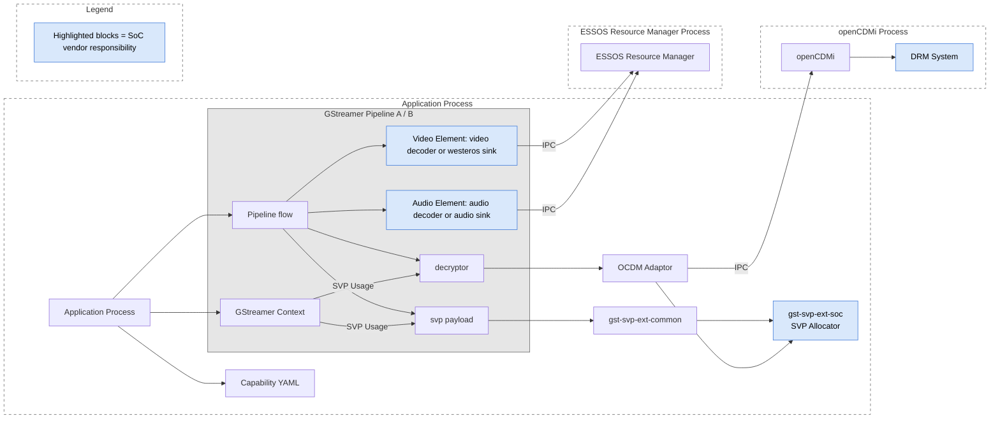
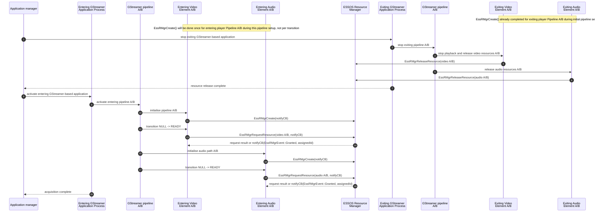
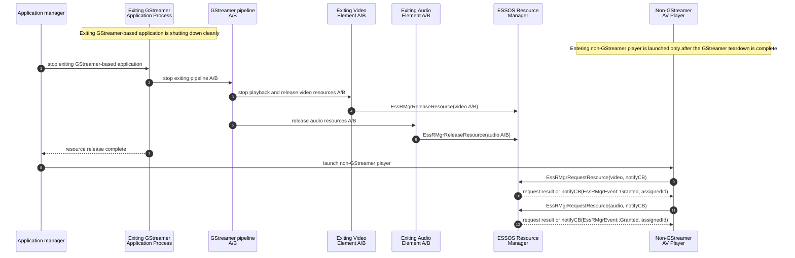
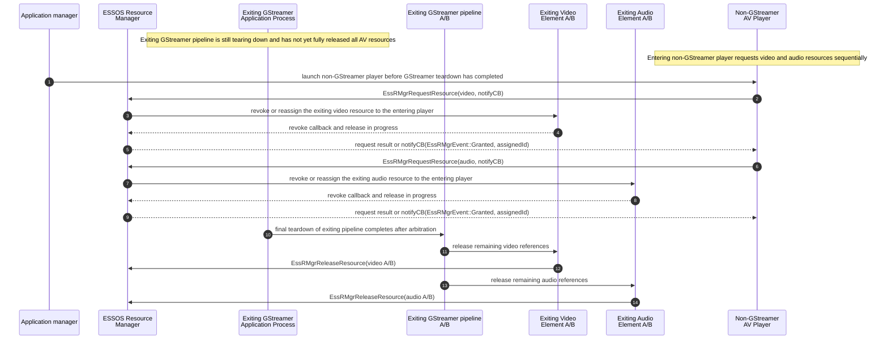
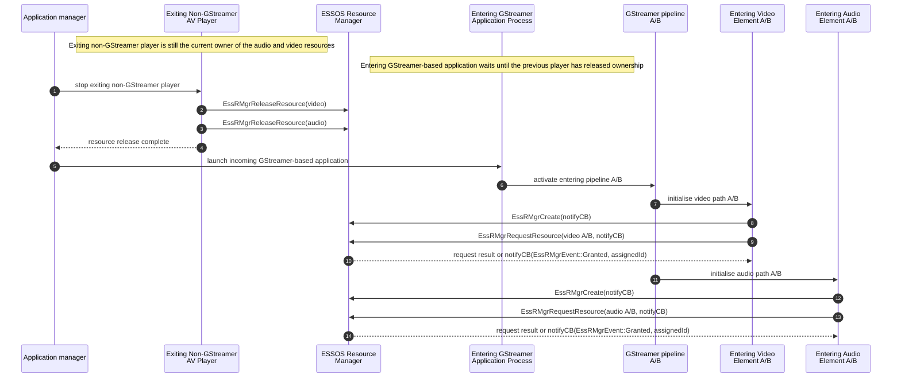
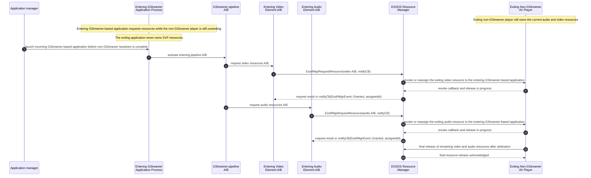

# Legacy AV HAL Extension for dual decode

## Table of contents

- [Revision history](#revision-history)
- [0. System context and deployment model](#0-system-context-and-deployment-model)
- [1. Purpose](#1-purpose)
- [2. Roles and responsibilities](#2-roles-and-responsibilities)
- [3. Scope](#3-scope)
- [4. Architecture facts and assumptions](#4-architecture-facts-and-assumptions)
- [5. GStreamer context and `res-usage` documentation](#5-gstreamer-context-and-res-usage-documentation)
- [6. Resource identification model](#6-resource-identification-model)
- [7. Video decoder and video plane resource model](#7-video-decoder-and-video-plane-resource-model)
- [8. Audio decoder resource model](#8-audio-decoder-resource-model)
- [9. Audio mixer resource model](#9-audio-mixer-resource-model)
- [10. SVP allocator resource model](#10-svp-allocator-resource-model)
- [11. DRM resource model](#11-drm-resource-model)
- [12. AV player transitions and resource acquisition](#12-av-player-transitions-and-resource-acquisition)
- [13. Audio behaviour in dual-decode modes](#13-audio-behaviour-in-dual-decode-modes)
- [14. Conformance and acceptance gates](#14-conformance-and-acceptance-gates)

**Status:** Draft for review.

**Specification version:** 0.1

## Revision history

| Version | Status | What changed | What reviewers should check |
|---|---|---|---|
| 0.1 | Draft for review | First version of the legacy AV HAL extension specification covering concurrent playback resource semantics and AV resource-management requirements. | Property semantics, capability reporting, resource selection, transition behaviour, and ESSOS integration requirements. |

### What this specification covers

- AV sync for dual-decode use cases.
- Video decoder and video plane resource selection using the existing `res-usage` property.
- Audio decoder resource handling for symmetric decoders.
- SVP allocator resource handling for asymmetric and symmetric platforms.
- DRM resource expectations for concurrent playback.
- AV player transition and resource-acquisition rules for application-managed GStreamer players and non-GStreamer players.

### What this specification does not cover

- AV sync for use cases other than dual decode.
- Unrelated platform features outside decoder, audio, SVP, DRM, and transition handling.
- Metrics HAL requirements.
- Frame-capture HAL behaviour.

---

## 0. System context and deployment model

This specification defines the contract between the middleware playback stack, vendor GStreamer plugins, and platform resource-management components for legacy concurrent dual-decode playback.



### Process and IPC boundaries

- **Application Process** owns playback-pipeline construction for GStreamer-based players.
- **ESSOS Resource Manager** arbitrates assignment and returns the concrete resource instance identifiers.
- **Video** and **audio** resource arbitration is performed by the relevant vendor element or sink, depending on the platform topology.
- **Vendor plugins** bind the returned `assignedId` values and any GStreamer-context signalling to the correct hardware resources.

### Contract scope

This specification defines the contract between:

- **Application layer / playback owner**, which creates and tears down the GStreamer-owned playback pipeline and owns application-level transition behaviour.
- **SoC vendor**, which provides the decoder, sinks, SVP handling, DRM integration, and resource-aware vendor plugins.
- **Vendor layer team**, which integrates the SoC delivery, capability YAML, and ESSOS resource-manager configuration.

---

## 1. Purpose

This specification defines how concurrent playback extends the legacy AV HAL surface without redesigning the legacy GStreamer pipeline model.

The goal is to support multiple playback pipelines in a single application process while preserving existing single-pipeline behaviour unless explicitly extended by this document.

The contract covers:

- new or extended sink properties;
- capability declaration and resource identification;
- selection of high-specification and low-specification video resources;
- audio-decoder and SVP resource allocation rules; and
- behaviour during transitions between GStreamer-based applications and non-GStreamer AV players.

## 2. Roles and responsibilities

| Role | Definition | Responsibilities |
|---|---|---|
| **Application layer / playback owner** | Owns the GStreamer-based playback pipeline and player transition logic. | Builds playback pipelines, tears down exiting pipelines, sets sink properties, propagates GStreamer context, and coordinates player transitions. |
| **SoC vendor** | Provides vendor GStreamer elements and platform resource integration. | Implements westeros sink, audio sink, decoder selection, SVP usage handling, DRM integration, assigned-resource binding, and AV sync for dual decode. |
| **Vendor layer team** | Integrates the SoC delivery into the platform image. | Supplies capability YAML, ESSOS resource-manager configuration, and any platform-specific resource identifiers consumed by application and vendor plugins. |

## 3. Scope

### In scope

- Single application process owning up to two playback pipelines.
- Pipeline independence for play, pause, seek, and trick mode.
- Independent AV sync per pipeline.
- Capability reporting for concurrent decode, mixing, SVP, and DRM.
- Existing resource-selection semantics using `res-usage` for asymmetric video-decoder selection.
- ESSOS-managed video-decoder and audio-decoder resources.
- DRM-session expectations for concurrent playback.
- Resource-acquisition rules during AV player transitions.

### Out of scope

- Platform topics unrelated to decoder, audio, SVP, DRM, and transition handling.
- Metrics collection and Metrics HAL behaviour.
- Frame-capture behaviour and APIs.
- A redesign of the legacy GStreamer pipeline topology.

## 4. Architecture facts and assumptions

### 4.1 Architecture facts

- A single application process may own multiple playback pipelines.
- Maximum of two playback sessions in one application process.
- Each pipeline operates independently and keeps its own play, pause, seek, and trick-mode state.
- AV sync is maintained independently inside each pipeline. No AV synchronisation is required between pipelines.
- During dual decode, AV sync remains the responsibility of the SoC vendor implementation.
- Existing SoC-vendor behaviour for a single playback pipeline remains unchanged unless explicitly extended by this specification.

### 4.2 Assumptions

- Legacy pipeline construction remains unchanged.
- New functionality is delivered primarily through sink properties, GStreamer context, capability YAML, and existing middleware orchestration.
- During dual decode, the SoC vendor may assume that the corresponding audio and video sinks belong to the same process.
- Where helpful for sink association inside the same playbin, the SoC vendor may use `gst_element_parent()` to locate the corresponding audio and video sinks that require AV synchronisation.
- Unsupported capability requests must fail positively rather than producing undefined behaviour.
- Capability reporting is available before runtime configuration occurs.

### 4.3 Capability reporting

Capability YAML shall report at least the following platform capabilities when supported:

- dual video decode;
- dual audio decode;
- audio mixing support;
- dual SVP support; and
- dual DRM support.

The capability YAML and ESSOS resource-manager configuration shall refer consistently to the same logical resources, including video decoder, audio decoder, video sink, audio sink, SVP allocator, and DRM-related platform identifiers where applicable.

### 4.4 Capability YAML

[TBC - Link to Capability schema to be added]

Capability YAML shall describe the declared resource model and list the supported concurrent-playback features together with the platform-specific resource classes used by the middleware.

It shall distinguish whether dual video decode, dual audio decode, audio mixing, dual SVP support, and dual DRM support are present for the relevant video and audio paths.

Example structure:

```yaml
capabilities:
  dualVideoDecode: true
  dualAudioDecode: true
  audioMixing: true
  dualSvpSupport: true
  dualDrmSupport: true
  videoDecoderResources:
    primary: high-spec
    secondary: low-spec
  svpResources:
    primary: high-bandwidth
    secondary: standard-bandwidth
```

The capability description and the ESSOS resource-manager configuration shall use the same logical names for the primary and secondary resource pools. Where a platform exposes limits on simultaneous playback, those limits shall be stated in the capability model and reflected in the accepted runtime transitions.

### 4.5 ESSOS Resource Manager

ESSOS Resource Manager is the platform arbitration layer for the video-decoder/display, audio-decoder/audio-output, and SVP paths. The application layer and vendor plugins shall request an assigned resource instance, apply the returned `assignedId`, release it during teardown, and destroy the ESSOS connection only when the resource-manager path is no longer needed.

[TBC - Documentation of ESSOS Resource Manager APIs to be added; see https://github.com/rdkcmf/westeros/blob/master/essos/essos-resmgr.h]

The platform-specific configuration shall document the concrete resource identifiers and any limits that apply to concurrent audio, video, and SVP acquisition. Where the platform exposes asymmetric pools, the configuration shall clearly distinguish the relevant high-specification and low-specification pools.

## 5. GStreamer context and `res-usage` documentation

This specification does not add a new GStreamer property. It documents the existing `res-usage` flag so that its role in dual-decode resource selection is explicit and consistent across implementations.

### 5.1 Existing `res-usage` flag

`res-usage` is an existing GStreamer property that continues to be used as defined by the current implementation. For dual-decode operation it is used to distinguish asymmetric video-decoder resources and to identify the intended resource profile for the video path.

| Property | Type | Purpose | Required behaviour |
|---|---|---|---|
| `res-usage` | Enum | Identifies the intended resource profile for the video path. | The property value shall continue to distinguish primary and secondary resource usage and shall participate in video-decoder selection as defined in Section 7. For asymmetric decoder platforms, `res-usage` distinguishes the high-specification UHD path from the lower-specification FHD path. |

### 5.2 Property application timing

- `res-usage` shall be set before the pipeline moves from `NULL` to `READY`, because the resource-owning element may request its ESSOS-managed resource during that transition.
- On asymmetric video-decoder platforms, the selected `res-usage` shall be used to choose the correct high-specification or low-specification decoder instance before resource acquisition begins.

## 6. Resource identification model

Resource selection across middleware and vendor plugins relies on consistent identifiers and usage signalling.

The platform shall provide capability YAML, ESSOS resource-manager configuration, and a stable mapping between logical usage and the assigned `assignedId` values used by vendor plugins.

The contract is simple: middleware decides the intent; ESSOS Resource Manager selects the concrete instance; vendor plugins open the selected resource; and GStreamer context is used when usage information must be visible beyond the sink that received the direct property.

## 7. Video decoder and video plane resource model

### 7.1 General requirements

All AV players supporting dual video decode shall use the application-managed GStreamer path for the concurrent-playback use case.

The platform shall support resource selection between a high-specification video decoder path and a low-specification video decoder path.

### 7.2 `res-usage` signalling and precedence

The middleware shall propagate the `res-usage` value through GStreamer context in addition to setting the `res-usage` property on westeros sink.

This dual signalling exists to support both of these cases:

- Dual Decode-capable platforms, where vendor plugins rely on GStreamer context to choose the appropriate decoder resource before data flow begins.
- Legacy platforms, where westeros sink property handling remains the deciding mechanism.

When the GStreamer-context value and the westeros sink property differ, the westeros sink property value shall take precedence.

### 7.3 Resource-class mapping

For platforms implementing asymmetric video resources:

- `res-usage = 7` indicates the high-specification decoder profile using full resolution, full quality, and full performance.
- `res-usage = 0` indicates the low-specification decoder profile.

The `res-usage` value shall be established before the pipeline transitions from `NULL` to `READY`, so that decoder selection can complete when the resource-owning element first requests the video decoder.

### 7.4 ESSOS interaction

The video resource-owning element, following the westeros-sink pattern, shall create its ESSOS Resource Manager connection once for the lifetime of the playback pipeline and shall request the video decoder during the GStreamer `NULL` to `READY` transition.

ESSOS Resource Manager shall return the appropriate video-decoder instance identifier through `assignedId` in the resource request result, either immediately from the request call or asynchronously through the registered notify callback.

The vendor video plugin shall use the returned `assignedId` to open the concrete video-decoder instance.

If ESSOS later issues a revoke event for that decoder, the owning element shall stop using the decoder, release any vendor-side resources associated with it, and call `EssRMgrReleaseResource()` before another player is granted the same decoder.

When playback is torn down and ESSOS communication is no longer required, the owning element shall destroy its ESSOS Resource Manager connection.

For legacy AV players not using the application-managed GStreamer path:

- only one video decoder is typically requested;
- the default usage value is the high-specification profile; and
- the higher-specification decoder identifier is therefore expected.

### 7.5 Video plane relationship

The high-specification video decoder is expected to pair with the high-specification video plane and PQ pipeline.

The low-specification decoder and associated plane may omit support for Dolby Vision or other PQ features on some platforms. That limitation shall be reflected in platform capability reporting.

## 8. Audio decoder resource model

### 8.1 General requirements

All AV players supporting dual audio decode shall use the application-managed GStreamer path for the concurrent-playback use case.

Audio decoder resources are treated as symmetric. This specification does not require an extension to an audio-usage enumeration analogous to the video `res-usage` profile.

### 8.2 ESSOS Resource Manager configuration

The ESSOS Resource Manager configuration shall advertise two available audio-decoder resources.

### 8.3 Example ESSOS configuration entries

The `essrmgr.conf` file is expected to contain two audio resource entries in the following form:

```text
audio: hardware
audio: hardware
```

### 8.4 ESSOS configuration and allocation

The ESSOS resource-manager configuration shall be extended to advertise both available audio-decoder resources.

When middleware requests an audio decoder:

- the first request shall receive the first available audio-decoder `assignedId`;
- the second request shall receive the second available audio-decoder `assignedId`; and
- no further usage-class distinction is required for symmetric audio decoders.

### 8.5 Vendor plugin behaviour

The audio sink or audio-decoder plugin that consumes ESSOS resource-manager results shall use the returned `assignedId` to decide which hardware audio-decoder instance to open.

The mapping from `assignedId` to the actual hardware decoder instance remains private to the vendor implementation.

The audio resource-owning element shall follow the same ESSOS communication lifecycle as the video case: create its ESSOS connection once for the lifetime of the playback pipeline, request the audio decoder during `NULL` to `READY`, accept either an immediate `assignedId` or an asynchronous callback grant, and release the resource with `EssRMgrReleaseResource()` when playback stops or when a revoke event is received.

When ESSOS communication is no longer required for that pipeline, the element shall destroy its ESSOS connection.

For legacy AV players not using the application-managed GStreamer path, only one audio decoder is typically requested.

## 9. Audio mixer resource model

### 9.1 Process-scoped mixer ownership

Audio-mixer usage for main and secondary audio inputs is tied to the Linux process that is currently using the mixer resource, such as the application process or a dedicated playback process.

For the purposes of this specification, process ownership applies to the media-stream inputs that feed the main and secondary mixer paths. It does not change the behaviour of other platform audio sources that are already allowed to mix through the existing audio system.

### 9.2 Behaviour during process handover

When a new Linux process starts using the audio mixer resource, the SoC vendor implementation shall ensure that any audio data still being injected by another process for primary or secondary playback inputs is ignored and is not mixed into the audible output.

This requirement applies to transitions involving both of these process categories:

- an application process using the legacy playback path; and
- a separate playback process using the GStreamer-managed playback path.

The purpose of this rule is to prevent stale or overlapping playback audio from an exiting process from leaking into the mixer while the entering process takes ownership of the playback audio path.

### 9.3 Non-playback audio sources

Application audio, System Audio, and TTS audio shall continue to be handled according to the existing platform mixing behaviour.

These audio classes are not excluded by the process-scoped ownership rule for main and secondary playback inputs. Any such input from any Linux process may continue to be mixed as supported by the platform's existing audio policy.

### 9.4 Conformance requirement

The SoC vendor shall provide mixer-input isolation such that a new owner of the playback mixer path cannot receive residual main or secondary audio injected by an older process once handover has occurred.

## 10. SVP allocator resource model

### 10.1 General requirements

All AV players supporting dual secure-video paths shall use the application-managed GStreamer path for the concurrent-playback use case.

Platforms shall declare whether their SVP allocator resources are asymmetric or symmetric.

### 10.2 Platform SVP pool declaration

The platform shall declare the available SVP pools for the dual-decode use case without requiring a dedicated ESSOS Resource Manager IPC path for SVP allocator selection.

### 10.3 Asymmetric SVP resources

On platforms where SVP allocator resources are asymmetric, middleware shall signal SVP usage through GStreamer context.

The recommended logical usage values are:

- `fullResolution` for the UHD-capable pool; and
- `standardResolution` for the FHD-capable pool.

On such platforms:

- the platform shall expose both the primary and secondary SVP pool definitions through the secure allocator metadata available to the pipeline;
- the application-managed GStreamer path shall propagate the selected SVP usage through GStreamer context before the first secure-buffer consumer binds the allocator;
- the first component that consumes the SVP buffer, such as a decryptor or SVP payload element, shall pass the usage to the vendor-side SVP integration; and
- vendor code shall use the usage value together with the pipeline role and pool identifier to bind the correct allocator resource.

The selected secure-resource instance shall therefore be resolved by the vendor implementation using the GStreamer context information sent along the path from application to the OCDM adaptor, `gst-svp-ext-common`, and `gst-svp-ext-soc`.

### 10.5 Symmetric SVP resources

On platforms where SVP allocator resources are symmetric:

- the SVP usage flag need not be signalled through GStreamer context for allocator selection;
- the platform shall still expose the available secure-resource instance metadata in the same way for the relevant secure-playback path; and
- the resource pool identifier or equivalent platform metadata is sufficient for vendor-resource binding.

Even on symmetric platforms, the secure-playback path shall keep the resource context for the lifetime of the playback pipeline, and the vendor implementation shall release or replace the selected allocator state only when playback stops or when the pipeline takes a new secure-resource configuration.

### 10.6 Legacy behaviour

For legacy AV players not using the application-managed GStreamer path:

- only one SVP allocator is typically requested; and
- the default expectation is the higher-specification allocator when such differentiation exists.

### 10.7 Extensions to the OCDM Adaptor, gst-svp-ext-common, and gst-svp-ext-soc

[TBC - The new APIs for OCDM Adaptor, gst-svp-ext-common and gst-svp-ext-soc to be defined]

The OCDM adaptor, `gst-svp-ext-common`, and `gst-svp-ext-soc` shall carry the minimum set of attributes required to resolve the correct secure-resource instance for the active playback session.

At a minimum, the secure-resource metadata shall include:

- the logical usage class for the resource, such as primary or secondary video or `fullResolution`/`standardResolution` SVP pool selection;
- the selected secure-resource instance or pool identifier for the concrete resource allocation;
- the pipeline or process ownership identifier used to distinguish the entering and exiting sessions; and
- any platform-specific key or allocator identifier required by the vendor implementation.

The integration shall ensure that the resource-owning element requests the allocator or decryptor state in the same order used by the platform's existing secure-playback flow, and shall not allow a later session to reuse stale resource state from an earlier owner.

### 10.8 GStreamer context structure for carrying SVP pool information

Where the platform requires usage information to be visible to elements other than the sink that received the direct property, the SVP usage information shall be carried in GStreamer context using a stable structure keyed by logical resource type.

The structure shall include at least the following fields:

- `usage` or equivalent logical resource class, such as `primary`, `secondary`, `fullResolution`, or `standardResolution`;
- `resource-id` or equivalent selected secure-resource instance or pool identifier;
- `resource-type`, such as `video`, `audio`, or `svp`; and
- `pipeline-role`, identifying the primary or secondary playback instance.

A representative example is shown below:

```text
GstStructure: "svp-info"
  usage = "fullResolution"
  resource-id = "primary-svp-pool"
  resource-type = "svp"
  pipeline-role = "primary"
```

The value passed in GStreamer context shall be read before the secure buffer is bound to the allocator, and the platform shall reject or fail positively when the context does not match an available resource instance.

## 11. DRM resource model

### 11.1 General requirements

Dual-DRM support applies to both video and audio paths. In a dual-decode implementation, the platform may therefore require up to four concurrent DRM sessions: one for the primary video path, one for the primary audio path, one for the secondary video path, and one for the secondary audio path.

DRM resources are not managed by ESSOS Resource Manager.

### 11.2 Provisioning expectations

The platform shall provision the relevant key identifiers for the playback session before the GStreamer pipeline is constructed.

This applies equally to encrypted video and encrypted audio data. Encrypted media passed during decryption shall carry sufficient key-identification information for the DRM implementation to select the correct decryption key.


## 12. AV player transitions and resource acquisition

### 12.1 General transition rules

Resource ownership shall be exclusive at any given time. For GStreamer-managed transitions, the application manager orders teardown of the exiting pipeline before startup of the entering one. For non-GStreamer players, the existing platform path remains responsible for AV ownership, with ESSOS arbitration only when a conflicting request arrives before teardown completes.

In all cases, the exiting player must release the relevant video and audio resources before the entering player can acquire them. SVP arbitration is not required between GStreamer-based applications because the application manager ensures the previous pipeline is torn down before the next one starts. Non-GStreamer players do not own SVP resources.

If ESSOS revokes one video resource during handover, the platform shall revoke the remaining video resources owned by the exiting player in the same transition to avoid mixed video ownership. Audio-mixer ownership remains process-scoped and follows Section 9.

Within one AV pipeline, `EssRMgrCreate()` is called once during playback setup; the owning element requests the resource during `NULL` to `READY`, and `EssRMgrDestroy()` occurs only when ESSOS communication is no longer needed.

### 12.2 GStreamer-based application to GStreamer-based application

For transitions between two GStreamer-based applications:

- the application manager orders teardown of the exiting pipeline and launch of the entering one;
- the exiting pipeline releases video and audio decoders before the entering pipeline requests them; and
- the entering pipeline waits for the release confirmation before it begins its next resource acquisition.

There is no delayed-release path for this transition; the application manager defines the ordering, and no SVP arbitration through ESSOS is required because the previous GStreamer pipeline is shut down before the next one acquires the same resources.

Orderly-release path, where the exiting application releases resources before the entering application requests them:



### 12.3 GStreamer-based application to non-GStreamer-based AV player

For transitions from a GStreamer-based application to a non-GStreamer player, the resource-safe behaviour is the same as the GStreamer-to-GStreamer case: the exiting pipeline must release the AV resources before the entering player can acquire them.

The platform shall support an orderly release path, and if the non-GStreamer player arrives before teardown completes, ESSOS Resource Manager may arbitrate the handover and revoke the exiting AV resources. There is no SVP revoke path for this transition because non-GStreamer players do not own SVP resources.

Orderly-release path, where the exiting GStreamer-based player releases resources before the entering non-GStreamer player requests them:



Disorderly-release path, where the entering non-GStreamer player requests AV resources before the exiting GStreamer-based application has fully released them:



### 12.4 Non-GStreamer-based AV player to GStreamer-based application

For transitions from a non-GStreamer player to a GStreamer-based application:

- the exiting non-GStreamer player releases AV resources through the current platform path when it is torn down;
- the entering GStreamer-based application does not rely on a delayed-release path; and
- if the non-GStreamer player is still active when the GStreamer application requests resources, ESSOS Resource Manager arbitrates the handover and revokes the exiting AV resources before granting the new owner.

The orderly-release path remains required because non-GStreamer applications such as HDMI In or Composite In may still be active while the GStreamer-based application starts. No SVP arbitration is required because the exiting non-GStreamer application never owns SVP resources.

Orderly-release path, where the exiting non-GStreamer player releases resources before the entering GStreamer-based application requests them:



Disorderly-release path, where the entering GStreamer-based application requests AV resources before the exiting non-GStreamer-based player has fully released them:



### 12.5 Non-GStreamer-based AV player to non-GStreamer-based AV player

For transitions between two non-GStreamer-based AV players, release occurs through the existing platform method.

This specification does not require application-managed GStreamer coordination in that case, but the platform shall still preserve exclusive ownership of the relevant AV resources.

The transition shall work according to the current non-GStreamer model already in place on the platform.

## 13. Audio behaviour in dual-decode modes

This specification does not redefine the application-facing audio UX policy, but the platform shall support at least these behavioural classes when declared by capability YAML:

- **Dual decode + dual mix**: both audio streams decoded and mixed, with independent volume control.
- **Dual decode + single audible output**: both streams continue decoding, but one stream may be muted through the platform's existing audio policy while AV sync is preserved.
- **Single audio decode + dual video decode**: only the primary stream performs audio decode, while the platform still supports other platform audio inputs as defined by the existing mixer design.

## 14. Conformance and acceptance gates

An implementation is conformant only when all of the following are true:

| # | Requirement |
|---|---|
| 1 | Existing single-pipeline behaviour remains unchanged unless extended by this specification. |
| 2 | Up to two playback pipelines in one application process can be represented by capability reporting when supported. |
| 3 | `res-usage` is available early enough to select the appropriate video decoder before the `NULL` to `READY` resource request is issued. |
| 4 | On asymmetric video-decoder platforms, `res-usage` distinguishes the high-specification UHD path from the lower-specification FHD path. |
| 5 | ESSOS `assignedId` values are used by vendor plugins to open the selected video-decoder and audio-decoder instances. |
| 6 | Audio decoder resources are treated symmetrically and are represented as multiple configured resources in ESSOS. |
| 7 | Audio mixer ownership for main and secondary playback inputs is process-scoped, and an entering process is isolated from stale playback audio injected by an exiting process. |
| 8 | Asymmetric SVP platforms signal SVP usage through GStreamer context and select the correct secure-resource instance for the active pipeline. |
| 9 | Symmetric SVP platforms do not require usage-based allocator selection and may define allocator resources symmetrically. |
| 10 | DRM-session provisioning occurs before pipeline construction and supports the platform's declared concurrent playback model. |
| 11 | Transition handling prevents mixed ownership that would produce overlapping or blended video from exiting and entering players. |
| 12 | Audio from an exiting process is ignored once the mixer is in use by the entering process, consistent with process-scoped mixer ownership. |
| 13 | ESSOS Resource Manager support is available for switching between non-GStreamer-based applications, and between non-GStreamer-based and GStreamer-based applications, including the revoke-driven arbitration path required when the competing application requests AV resources before teardown completes. |

Failure of any mandatory gate means concurrent playback is unsupported on that implementation or supported only within a narrower capability set explicitly declared by the platform.

